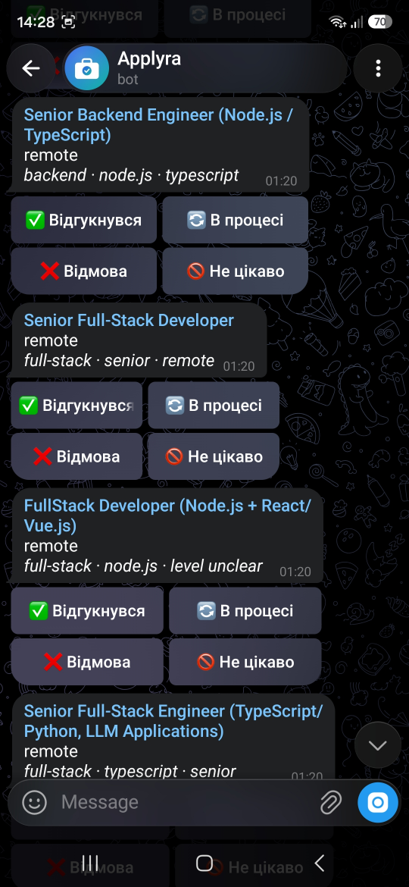
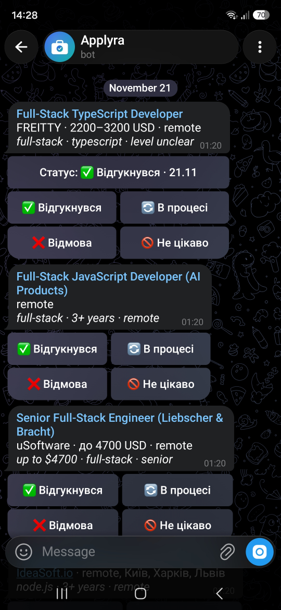
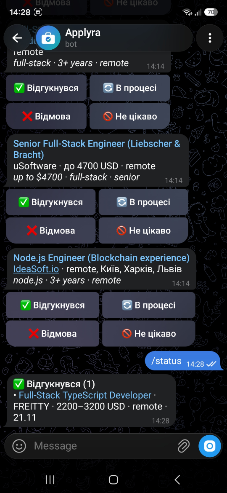
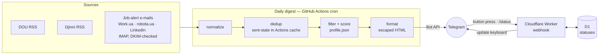

<div align="center">


# Applyra

**A daily Telegram digest of relevant vacancies from Ukrainian job sites — filtered and ranked by your profile,
with one-tap application tracking right in the chat.**

[](https://github.com/Oleg-Baltarovych/Applyra/actions/workflows/ci.yml)


[](LICENSE)

</div>

<table>
  <tr>
    <td align="center" width="33%"><br><sub>Daily digest, one message per vacancy</sub></td>
    <td align="center" width="33%"><br><sub>Mark a status with one tap</sub></td>
    <td align="center" width="33%"><br><sub><code>/status</code> — all applications at a glance</sub></td>
  </tr>
</table>

## Why

Job hunting in Ukraine means checking DOU, Djinni, Work.ua, robota.ua and LinkedIn every day, skimming the same
reposts and losing track of where you have already applied. Applyra does the checking once a day and sends only
what is **new** and **fits your profile** — and lets you track every application without leaving Telegram.

## Features

- **One digest a day** — a short header, then each vacancy as its own message: title (linked), company, salary,
  work mode, and _why it matched_ (`backend · node.js · 3+ years`).
- **Profile-based ranking** — a committed `profile.json`: stack keywords, required skills, excluded stacks and
  titles, level, remote/hybrid, salary floor (UAH → USD), languages. Hard rejects first, then a score with reasons.
- **No duplicates** — canonical URLs, a fuzzy `company + title` key, and cross-site matching for DOU/Djinni
  reposts; nothing is ever sent twice.
- **Application tracking** — ✅ Applied · 🔄 In progress · ❌ Rejected · 🚫 Not interested under every vacancy.
  The status shows on the message; "Not interested" removes it from the chat; `/status` and `/hidden` list
  everything with links.
- **Quiet by design** — only the digest header makes a sound; vacancy messages arrive silently.
- **Failure alerts** — if a site stops answering or the run fails, you get a ⚠️ message instead of silence.
- **Zero cost** — GitHub Actions cron + a free Cloudflare Worker and D1 table. No server to run or pay for.

## How it works



Two independent parts share only the callback-data protocol
([`status.ts`](apps/digest/src/status.ts)):

- **`apps/digest`** — a one-minute batch job: fetch → normalize → dedup → filter/score → format → send →
  remember. Pure logic (normalize, dedup, filter, format) has no I/O; a vacancy is marked as sent only after
  Telegram accepted its message, so a failed run never loses or duplicates a vacancy.
- **`apps/bot`** — a Cloudflare Worker that receives button presses at the moment they happen, stores the status
  in D1 and redraws the message keyboard.

## Tech stack

| Area               | Choice                                                                                                          |
| ------------------ | --------------------------------------------------------------------------------------------------------------- |
| Language           | TypeScript (strict, `noUncheckedIndexedAccess`), run directly by **Node 26** via type stripping — no build step |
| Monorepo           | pnpm 11 workspaces: `@applyra/digest`, `@applyra/bot`, `@applyra/config`                                        |
| Scheduling         | GitHub Actions cron, state in the Actions cache                                                                 |
| Bot backend        | Cloudflare Workers + D1 (SQLite), deployed with Wrangler                                                        |
| Telegram           | Bot API over global `fetch` (HTML messages, inline keyboards, webhook with a secret token)                      |
| E-mail input       | `imapflow` (read-only IMAP), DKIM result checked from the receiving server's `Authentication-Results`           |
| Testing            | Vitest — 181 tests, recorded and anonymised feed fixtures, no network                                           |
| Quality & security | ESLint, Prettier, gitleaks, osv-scanner, `pnpm audit`, Semgrep, actionlint — one CI job; Renovate               |

## Engineering notes

- **Untrusted input everywhere** — feed text is HTML-escaped with size budgets counted in _escaped_ characters;
  only `http(s)` links survive; the RSS parser is linear and capped (2 MB, 300 items).
- **Secrets never leak** — the bot token is part of the Bot API URL, so errors carry only the HTTP status and
  Telegram's description; network errors are re-thrown without the original message; logs go through a redactor.
- **Authentic alert e-mails only** — a mail counts only if the receiving server (`mx.google.com`) reports a
  strict DKIM pass for the job site's own domain; forged "From" headers are ignored.
- **Locked-down bot** — the webhook requires Telegram's secret header (constant-time compare), serves only the
  owner's chat, caps body size and parses updates defensively.
- **Polite sources** — public feeds only, one request per feed per run, a descriptive User-Agent, timeouts and
  no redirects. No scraping behind logins, robots rules or CAPTCHAs.
- **Decisions are written down** — [`docs/adr/`](docs/adr) (architecture decision records) and
  [`docs/spec.md`](docs/spec.md).

## Project structure

```
apps/
  digest/        daily job: sources/ (DOU, Djinni, e-mail), normalize/, dedup, filter, format, telegram, state
  bot/           Cloudflare Worker: webhook, status store (D1), /status and /hidden
packages/
  config/        shared tsconfig + ESLint config
docs/            spec.md, CONTEXT.md, adr/
.github/         CI (one job) and the daily Digest workflow
```

## Set up your own

<details>
<summary>Step-by-step (about 15 minutes, everything on free plans)</summary>

1. **Create a bot**: in Telegram, talk to [@BotFather](https://t.me/BotFather) → `/newbot` → copy the token.
2. **Get your chat id**: send any message to your new bot, then open
   `https://api.telegram.org/bot<TOKEN>/getUpdates` in a browser and copy `result[].message.chat.id`.
3. **Fork this repo** and create the Environment `digest` (Settings → Environments), restricted to `main`, with:
   - environment secrets `TELEGRAM_BOT_TOKEN`, `TELEGRAM_CHAT_ID`
   - variable `DIGEST_SOURCES` — comma-separated source names, e.g. `dou,djinni`
4. **Optional — Work.ua / robota.ua / LinkedIn** (no public feeds): create a dedicated Gmail box with 2FA and an
   App Password, subscribe it to the sites' job alerts, add secrets `IMAP_USER` / `IMAP_PASSWORD` to `digest`,
   and add `email` to `DIGEST_SOURCES`. The digest only reads that inbox.
5. **Optional — status buttons** (free Cloudflare account): in `apps/bot` run `pnpm exec wrangler login`,
   `pnpm exec wrangler d1 create applyra` (put the id into `wrangler.toml`), `pnpm db:migrate`, `pnpm run deploy`,
   then `node --env-file=../../.env scripts/setup.ts https://applyra-bot.<subdomain>.workers.dev` — it sets the
   Worker secrets and the bot webhook.
6. **Edit your profile**: [`apps/digest/profile.json`](apps/digest/profile.json) — preferences only, it is
   committed. Format: [docs/spec.md](docs/spec.md#profile).
7. The [Digest workflow](.github/workflows/digest.yml) runs daily at 05:17 UTC; start it by hand from the Actions
   tab (optionally as a dry run).

</details>

## Run locally

Requires Node 26 and pnpm 11 (`npm i -g pnpm`).

```sh
pnpm install
pnpm --filter @applyra/digest dry-run    # fake source + example profile, prints the digest, sends nothing
pnpm --filter @applyra/digest start -- --dry-run --source=dou,djinni    # real feeds, sends nothing
pnpm check                               # lint, format, typecheck, tests
```

A real send needs `TELEGRAM_BOT_TOKEN` / `TELEGRAM_CHAT_ID` in a root `.env` (see `.env.example`); then from
`apps/digest`: `node --env-file=../../.env src/main.ts --source=dou,djinni`.

## License

[MIT](LICENSE) © 2026 Oleg Baltarovych
