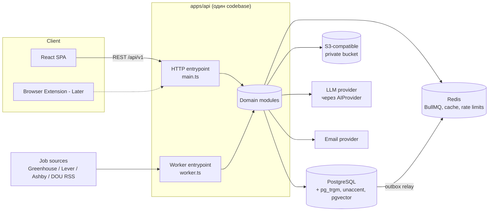
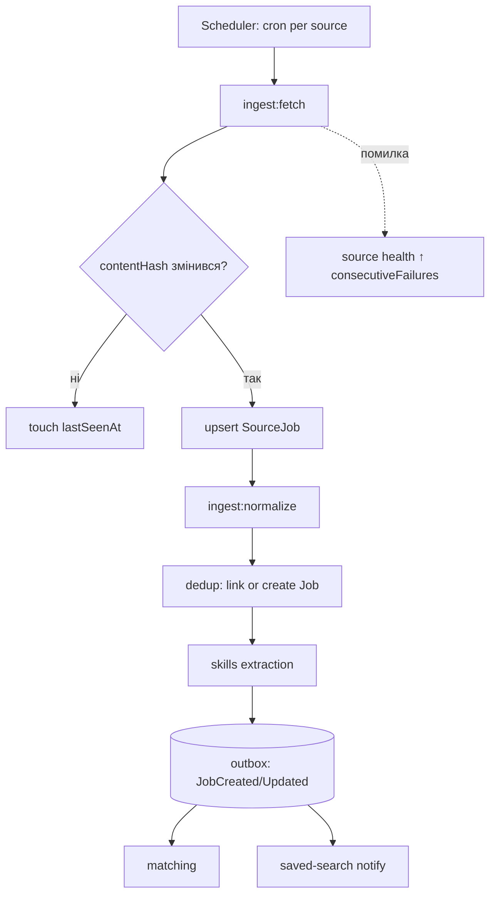

# Applyra — SPEC.md

> **Версія:** 2.0 (переробка blueprint v1.0)
> **Статус:** Draft, готовий до старту реалізації
> **Автор / власник:** Oleg Baltarovych
> **Мова інтерфейсу:** English (UA — друга мова, пізніше)
> **Призначення документа:** єдине джерело правди для розробки, зокрема для AI coding agent. Якщо код суперечить цьому документу, треба виправити або код, або документ (через ADR), але не мовчки розходитися.

---

## 0. Як читати цей документ

| Розділ | Для чого |
|---|---|
| 1–3 | Навіщо проєкт, для кого, які рішення щодо scope ухвалено |
| 4 | **Релізи та точний обсяг кожного** (головний розділ для планування) |
| 5 | Функціональні вимоги з acceptance criteria |
| 6–12 | Архітектура, дані, API, фонові задачі, AI, безпека |
| 13–16 | UI, тестування, інфраструктура, observability |
| 17 | Як проєкт працює на резюме та портфоліо |
| 18–21 | Roadmap, ризики, відкриті питання, правила для AI agent |

Позначки пріоритету: **R0 / R1 / R2 / R3 / Later** (див. розділ 4).

---

## 1. Контекст і цілі

### 1.1. Що це

Applyra — web-застосунок, персональний робочий простір для пошуку роботи: вакансії з різних джерел в одному місці, CRM для відгуків, пояснюваний match score і AI-помічник для рутинних текстових задач.

**Позиціонування:** _Your job search, under control._ Applyra не намагається бути ще одним job board. Головне в ньому — **pipeline і рішення**, а не кількість вакансій.

### 1.2. Три цілі в порядку пріоритету

1. **Портфоліо.** Production-grade full-stack проєкт, який можна показати на співбесіді: задеплоєний, з demo-акаунтом, тестами, CI, ADR і зрозумілим README. Він має демонструвати навички, які важко показати в CRUD-проєктах: ingestion, черги, дедуплікацію, пошук, AI зі structured output, безпеку, observability.
2. **Dogfooding.** Автор зараз сам шукає роботу (Full-stack, remote, переважно український ринок: Djinni, DOU, robota.ua, LinkedIn). Перший реліз (R0) має замінити йому Google Sheets уже за 2–3 тижні. Це головне джерело реального фідбеку.
3. **Комерційний потенціал.** Залишається опцією, але **не впливає на рішення до R3**. Монетизація, billing і тарифи поза scope цього документа.

### 1.3. Не-цілі (явно)

- Не автоматичне подання заявок (auto-apply) — ні зараз, ні пізніше без окремого рішення.
- Не scraping сайтів в обхід ToS, авторизації, CAPTCHA або anti-bot механізмів.
- Не мікросервіси, не окремий search-кластер, не нативні мобільні застосунки.
- Не multi-tenant для команд або рекрутерів.

---

## 2. Користувач і сценарії

### 2.1. Основна персона

**Middle/Senior IT-фахівець з України, який активно шукає remote-роботу.**

- Сидить на 3–5 платформах: Djinni, DOU, robota.ua / work.ua, LinkedIn, кар'єрні сторінки компаній.
- Частина можливостей **вхідні**: рекрутер сам пише в Djinni, LinkedIn або Telegram. Вакансії як окремої сторінки часто немає взагалі.
- Зарплати переважно в USD/міс, інколи gross/net, інколи «від».
- Типовий біль — **ghosting**: після відгуку тиша, і людина забуває, куди і коли подавалася і чи варто нагадати про себе.
- Має 1–3 версії CV під різні ролі.

### 2.2. Ключові jobs-to-be-done

| # | Сценарій | Реліз |
|---|---|---|
| J1 | «Знайшов вакансію — за 15 секунд зберіг її разом з усіма полями» | R0 |
| J2 | «Бачу всі свої відгуки, їхній статус і що робити далі» | R0 |
| J3 | «Мені нагадали зробити follow-up, і я не загубив можливість» | R0 |
| J4 | «Розумію, які вакансії реально мені підходять і чому» | R2 |
| J5 | «Не бачу ту саму вакансію п'ять разів із різних джерел» | R2 |
| J6 | «Швидко отримав розбір вакансії, питання до рекрутера й чернетку відповіді» | R3 |
| J7 | «Бачу, що в моєму пошуку працює, а що ні (джерела, конверсія)» | R1 (база) / R2 |

---

## 3. Ключові рішення щодо scope (відносно blueprint v1.0)

Blueprint v1.0 описував повний комерційний SaaS. Для однієї людини, яка паралельно шукає роботу, такий обсяг не дійде до релізу (сам документ називає це ризиком №1). Тому в цій версії:

| # | Рішення | Чому |
|---|---|---|
| D1 | MVP розбито на **R0 → R1 → R2 → R3**, кожен реліз окремо деплоїться і корисний сам по собі | 25 пунктів «Must Have» у v1.0 — це не MVP |
| D2 | **Ручний capture + URL capture (JSON-LD → LLM)** — основне джерело вакансій у R0–R1. Автоматичні адаптери з'являються в R2 і тільки для джерел із публічним API або feed | Продукт корисний без інтеграцій (принцип v1.0, тепер підкріплений планом) |
| D3 | Перші адаптери: **Greenhouse, Lever, Ashby** (публічні job board API) і **DOU** (RSS). Djinni, robota.ua, work.ua і LinkedIn — **тільки user-initiated capture** | Ці джерела не мають відомого публічного API для пошукача. Будь-яке джерело перед реалізацією проходить ToS-check (розділ 9.4) |
| D4 | **Matching v1 детермінований** (словник навичок + ваги), семантика через pgvector — у R3 | Детермінований скоринг тестується unit-тестами і пояснюється без LLM |
| D5 | Розділи «My Matches», «Interviews», «AI Assistant» **не окремі сторінки в R1**: matches — це сортування/фільтр у Jobs, інтервʼю — частина Application, AI — контекстні кнопки | Менше поверхні, швидший реліз |
| D6 | Статуси спрощено: `UserJob.state` (VIEWED/SAVED/HIDDEN) окремо від `Application.status`. «Applied» не дублюється в стані вакансії | У v1.0 «Saved» був і в стані вакансії, і в pipeline |
| D7 | Додано `Application.origin` (сам подався / рекрутер написав / referral) і статус **GHOSTED** | Реалії українського ринку (Djinni inbound, тиша після відгуку) |
| D8 | `job_source_links` прибрано: `SourceJob.jobId` (кожна публікація належить рівно одній канонічній вакансії) | Зайва таблиця many-to-many для зв'язку one-to-many |
| D9 | Вакансії мають **visibility**: публічний каталог (ingestion) і приватні (manual capture користувача) | У v1.0 незрозуміло, чи бачать інші користувачі вручну додану вакансію. Це privacy-проблема |
| D10 | API і worker — **один NestJS codebase із двома entrypoint** | Гарантує відсутність дублювання бізнес-логіки між API і фоновими задачами |
| D11 | Додано **transactional outbox** для доменних подій | Надійна доставка подій у черги без втрат і дублів. Сильний технічний пункт для співбесіди |
| D12 | Монетизація, billing, Company Intelligence, Autofill, AI-чат із діями — **Later** | Не впливають на цінність перших релізів |

---

## 4. Релізи та обсяг

> Орієнтовні строки розраховані на соло-розробку ~15–20 год/тиждень. Це оцінка, а не зобов'язання.

### R0 — «Tracker for myself» (≈2–3 тижні)

**Мета:** автор переносить свій пошук із таблиці в Applyra і користується щодня.

- Monorepo, Docker Compose, CI (lint, typecheck, test, build).
- Auth: email + password, Google OAuth, сесії.
- Ручне створення вакансії (форма) і **capture: paste URL та/або текст вакансії** → чернетка з полями (спершу JSON-LD, без LLM).
- Applications: CRUD, статуси, Kanban (drag & drop), Table, Detail, Timeline.
- Next action + reminder (in-app), список «Today / Overdue».
- Імпорт CSV (міграція з Google Sheets) і експорт CSV/JSON.
- Деплой на staging.

**Exit criteria:** усі поточні відгуки автора в Applyra; щоденне використання протягом тижня без повернення до таблиці.

### R1 — «Public MVP / Portfolio-ready» (≈3–4 тижні)

- Career Profile: досвід, навички (зі словником та aliases), мови, preferences, hard filters.
- Documents: завантаження CV (PDF/DOCX), версії, прив'язка версії до заявки.
- Jobs: список, пошук (Postgres FTS + trigram), фільтри, сортування, save/hide.
- LLM-extraction у capture (fallback, коли JSON-LD немає), з обов'язковим підтвердженням користувачем.
- Dashboard: Today, upcoming interviews, stale applications, тижнева статистика.
- Analytics (base): funnel, response rate, розбивка по каналах.
- Email-нагадування + daily digest.
- Data export (повний), видалення акаунта.
- **Demo-акаунт** із синтетичними даними, скидання щоночі.
- Production deploy, README зі скріншотами, 5+ ADR.

**Exit criteria:** незнайомий рекрутер або інженер може відкрити посилання, зайти в demo і за 2 хвилини зрозуміти, що робить продукт.

### R2 — «Discover & Match» (≈3–4 тижні)

- Ingestion: адаптери Greenhouse, Lever, Ashby (per-company boards зі списку), DOU RSS.
- Нормалізація, salary normalization (USD/міс), дедуплікація (рівні 1–4), source health.
- Matching v1 (детермінований) з поясненням, confidence і unknowns.
- Saved searches + digest нових результатів.
- Match feedback.
- Telegram-бот для нагадувань (Could).
- Observability: OpenTelemetry traces API → queue → worker.

### R3 — «AI Assistant» (≈2–3 тижні)

- AI tasks: Analyze Vacancy, Tailor CV suggestions, Cover letter / recruiter message, Recruiter reply, Interview prep pack.
- AiRun log, бюджет на користувача, кешування.
- Embeddings (pgvector) і семантичний компонент matching.
- Golden-set eval для extraction і analyze-job.

### Later (без строків)

Browser extension (MV3), AI-чат із діями (tool calling + confirm), Google Calendar sync, Skill Gap Analyzer, Salary analytics, Company notes/intelligence, локалізація UA, монетизація.

---

## 5. Функціональні вимоги

Формат: короткий опис → **AC** (acceptance criteria, які перевіряються тестами або вручну).

### 5.1. Auth & Account — R0

- Sign up / sign in через email + password, Google OAuth, sign out, reset password, email verification (R1).
- Сесії в HttpOnly Secure cookie, revoke усіх сесій.
- **AC:**
  - Неавторизований запит до будь-якого `/api/v1/*`, крім auth і health, повертає 401.
  - Після reset password усі інші сесії інвалідуються.
  - Видалення акаунта (R1) видаляє всі персональні дані та файли протягом ≤24 год (soft delete → hard delete job). Проходить E2E-тест.

### 5.2. Job capture — R0 (JSON-LD), R1 (LLM)

Основний спосіб додати вакансію.

**Flow:**
1. Користувач вставляє URL і/або текст вакансії (кнопка «+ Add job», хоткей `N`).
2. Backend (якщо є URL) робить **один** safe fetch (див. 11.4 SSRF) → шукає `schema.org/JobPosting` у JSON-LD → мапить поля.
3. Якщо JSON-LD немає або полів не вистачає, а користувач вставив текст → LLM extraction (R1) у Zod-схему `JobDraft`.
4. Повертається **чернетка** з полями й позначкою джерела кожного поля (`json_ld | llm | user`) та confidence.
5. Користувач редагує й підтверджує → створюється `Job` (visibility = PRIVATE, owner = user) + опційно одразу `Application`.

**Дедуп на capture:** якщо canonical URL уже є в публічному каталозі, створюється `UserJob` на публічну вакансію, а не приватна копія. Якщо вже є приватна вакансія користувача з тим самим URL, система показує «You already saved this» з посиланням.

**AC:**
- Сторінка без доступу (403, CAPTCHA, login wall) → зрозуміле повідомлення «Paste the job text instead», жодних повторних спроб.
- Жодне поле, витягнуте LLM, не зберігається без підтвердження користувачем.
- Original URL зберігається завжди, коли його надали.

### 5.3. Applications (CRM) — R0

**Статуси (`ApplicationStatus`):**

```
WISHLIST → APPLIED → SCREENING → INTERVIEW → TEST_TASK → OFFER → ACCEPTED
                                     ↘ REJECTED · WITHDRAWN · GHOSTED (термінальні, але можна reopen)
```

- Переходи **не лінійні**: дозволено будь-який, кожен пишеться в `ApplicationEvent` (`fromStatus`, `toStatus`, `occurredAt` — може бути в минулому).
- `archivedAt` — окремо від статусу (архів ≠ відмова).
- `origin`: `SELF_APPLIED | RECRUITER_OUTREACH | REFERRAL | OTHER`.
- `channel`: де відбувається комунікація (`djinni | dou | linkedin | email | telegram | company_site | other`).
- Заявка може існувати **без вакансії** (рекрутер написав у Telegram): тоді обов'язкові `companyName` і `roleTitle`.
- Унікальність: одна активна заявка на (user, job).

**Views:**
- **Kanban:** колонки = статуси (термінальні згорнуті), drag & drop (`dnd-kit`), optimistic update з rollback.
- **Table:** sorting, filtering, search, column visibility, bulk archive, export.
- **Detail (drawer + повна сторінка):** поля, timeline, notes (markdown), contacts, interviews, прикріплена версія CV, next action.

**Stale detection:**
- `APPLIED` без активності N днів (default 7, налаштовується) → пропозиція follow-up.
- Без активності M днів (default 21) → пропозиція позначити `GHOSTED`. Лише пропозиція, без автозміни.

**AC:**
- Перетягування картки створює рівно один event; повтор того самого запиту (retry) не створює дубль (idempotency key).
- Timeline сортується за `occurredAt` і коректно показує ретроспективні події.
- CSV-імпорт: мапінг колонок у UI, preview перших 10 рядків, звіт про помилки по рядках.

### 5.4. Reminders & Follow-ups — R0 (in-app), R1 (email), R2 (Telegram)

- `nextActionText` + `nextActionAt` на заявці автоматично створюють/оновлюють reminder.
- Типи: `FOLLOW_UP | INTERVIEW | DEADLINE | CUSTOM`.
- Дії з reminder: Done, Snooze (1 день / 3 дні / дата), Cancel.
- Шаблони follow-up (R1, статичні), AI-чернетка (R3). **Нічого не надсилається від імені користувача.** Applyra лише копіює текст у буфер або відкриває `mailto:`.
- **AC:** reminder спрацьовує один раз (unique `deliveryKey`), з урахуванням timezone користувача і quiet hours.

### 5.5. Interviews — R1 (частина Application)

- Поля: kind (`RECRUITER_SCREEN | TECHNICAL | SYSTEM_DESIGN | BEHAVIORAL | TEST_TASK_REVIEW | FINAL | OTHER`), startsAt, duration, timezone, meetingUrl, interviewers, prep notes, debrief notes, outcome.
- Автоматичний reminder за 24 год і за 1 год (налаштовується).
- Debrief-шаблон: «які питання ставили / що було складно / що повторити / наступні кроки».
- Prep pack від AI — R3.
- Експорт `.ics` (R1) — дешевий замінник Calendar sync.

### 5.6. Career Profile — R1

- Personal: name, location, timezone, links (LinkedIn, GitHub, portfolio).
- Summary: headline, about, years of experience, seniority, target roles.
- Work experience: company, position, dates, description, achievements[], skills[].
- Education, Languages (CEFR).
- Skills: з каталогу (autocomplete + aliases: `node`, `nodejs`, `node.js` → `Node.js`), level 1–5, years, last used, preference (`PREFERRED | NEUTRAL | AVOID`).
- Preferences: work modes, employment types, countries/timezones, salary min/desired + currency + period, relocation, excluded companies.
- **Hard filters:** користувач сам позначає, які preferences є жорсткими (наприклад, `remote only` = hard, `salary min` = soft).
- **AC:** зміна профілю ставить у чергу перерахунок matching (R2) не частіше ніж раз на 5 хв (debounce).

### 5.7. Documents / CV — R1

- Upload PDF/DOCX ≤ 5 MB → pre-signed URL у приватний bucket.
- Документи **immutable**: «редагування» = нова версія в тій самій `versionGroup`.
- Default CV; заявка зберігає посилання на **конкретну версію**.
- Parsing (R1): витяг тексту (pdf: `pdfjs`/`unpdf`, docx: `mammoth`) → збереження `parsedText`.
- Розбір у Career Profile (R3, LLM): показ diff «що знайдено → що додати», застосування тільки після підтвердження.
- **AC:** немає публічних URL на файли; download — лише через short-lived signed URL після перевірки власника.

### 5.8. Jobs / Discover — R1 (приватні та каталог), R2 (ingestion)

- Список: картки з title, company, location/work mode, salary (оригінал + нормалізована), seniority, ключові навички, дата, джерело(а), match score (R2), стан (saved/hidden).
- **Пошук:** title, company, skills, description. Часткові збіги та помилки в написанні (pg_trgm).
- **Фільтри (R1):** work mode, seniority, salary min (USD/міс), salary disclosed, employment type, country, date posted, source, skills (include/exclude), excluded companies, saved/hidden.
- **Фільтри (R2):** min match score, English level.
- Сортування: newest, salary, match (R2), relevance (якщо є query).
- Cursor pagination.
- Job detail: усі поля, опис (sanitized HTML), джерела-дублікати, match explanation (R2), notes, кнопки «Create application», «Open original».
- **Saved searches (R2):** name, query (Zod-схема `JobQuery`), notify (`NONE | DAILY | WEEKLY`), лічильник нових з `lastSeenAt`.

### 5.9. Matching — R2 (v1), R3 (semantic)

Див. алгоритм у розділі 8.3.

- Результат: `score 0–100 | null`, `confidence 0–1`, `excluded` + причини, breakdown по компонентах, strengths / gaps / unknowns.
- **Відсутні дані ≠ 0 балів**: компонент без даних отримує `unknown`, знижує confidence, але не score.
- UI: бейдж (Strong ≥ 80 / Good ≥ 60 / Weak), popover із поясненням, «Why?» на job detail.
- Feedback: `GOOD_MATCH | NOT_RELEVANT | SALARY_TOO_LOW | WRONG_SENIORITY | WRONG_LOCATION | MISSING_SKILL | NOT_INTERESTED_COMPANY`. У v1 feedback лише зберігається й показується в analytics. Автотюнінг ваг — Later.
- **AC:** golden-set із ≥ 20 пар (профіль, вакансія) з очікуваними діапазонами score у unit-тестах. Будь-яка зміна алгоритму піднімає `algorithmVersion`.

### 5.10. AI Assistant — R1 (extraction), R3 (решта)

| Task | Реліз | Input (мінімальний контекст) | Output |
|---|---|---|---|
| `extract-job` | R1 | текст вакансії | `JobDraft` |
| `analyze-job` | R3 | вакансія + skills/experience summary | summary, strengths, gaps, unknowns, red flags, questions to ask |
| `tailor-cv` | R3 | вакансія + обрана версія CV | список пропозицій `{section, original, suggested, reason}` |
| `draft-message` | R3 | вакансія + профіль + тип (cover letter / recruiter intro / follow-up) + тон | текст + пояснення |
| `recruiter-reply` | R3 | повідомлення рекрутера + контекст заявки | 3 варіанти (short / professional / negotiation) |
| `interview-prep` | R3 | вакансія + профіль + notes | technical / behavioral questions, questions to ask, checklist |
| `parse-cv` | R3 | parsed text CV | структуровані секції профілю |

Правила (обов'язкові):
- Користувач бачить, **які дані** підуть у запит (список «Context used: Skills, Experience (3), Vacancy»).
- AI **не вигадує** досвід, цифри, компанії. Output-схеми містять поле `evidence` для кожного твердження про кандидата. Твердження без evidence UI позначає як припущення.
- Будь-який результат AI — **пропозиція**: Accept / Edit / Discard. Оригінали документів не змінюються.
- AI не має доступу до БД і не виконує дій (AI-чат із діями — Later, тільки з confirm).

### 5.11. Notifications — R0 (in-app), R1 (email + digest), R2 (Telegram)

- Події: reminder due, interview soon, stale application, new saved-search results (R2), export ready.
- Налаштування по типу × каналу, quiet hours, timezone. За замовчуванням — daily digest, а не окремий лист на кожну подію.

### 5.12. Dashboard — R1

- **Today:** overdue та сьогоднішні reminders, інтервʼю найближчих 7 днів.
- **Pipeline:** кількість по статусах (клік → Applications із фільтром).
- **Needs attention:** stale applications.
- **This week:** applications sent, responses, interviews.
- **New for you (R2):** топ нових вакансій за match.
- Quick actions: Add job, Add application, Log recruiter message.

### 5.13. Analytics — R1 (base), R2

- **Funnel** (з events, не з поточного статусу): скільки заявок **досягли** кожного етапу.
- Response rate = заявки, що вийшли за `APPLIED` / усі `APPLIED`.
- Розбивка по `channel` та `origin` (inbound vs outbound, де відповідають частіше).
- Median time-to-first-response.
- Скрізь показувати `n`. Коли n < 5, блок отримує позначку «not enough data».
- R2: source performance для каталогу, salary distribution у збережених вакансіях.

### 5.14. Privacy controls — R1

- Export all data (JSON + файли CV у zip) → async job → посилання на 24 год.
- Delete account, delete окремих документів і заявок.
- AI settings: увімкнути/вимкнути AI, які частини профілю дозволено передавати.

---

## 6. Архітектура

### 6.1. Підхід

**Modular monolith** на NestJS + **окремий worker-процес із того самого codebase** + PostgreSQL + Redis (BullMQ).



### 6.2. Правила модульності

- Модуль = NestJS module у `src/modules/<name>` з публічним `index.ts` (service interface + DTO-типи). Імпорт внутрішніх файлів іншого модуля **заборонено**: ESLint `no-restricted-imports` або `eslint-plugin-boundaries`.
- Controllers — лише HTTP (парсинг, auth context, виклик service, мапінг відповіді).
- Бізнес-логіка — у services та чистих domain-функціях (`*.domain.ts`) без залежностей від Nest/Prisma. Їх найпростіше тестувати.
- Міжмодульні побічні ефекти йдуть через **доменні події** (outbox), а не прямі виклики, коли ефект асинхронний (перерахунок matching, нотифікації).
- Worker реєструє BullMQ processors, які викликають ті самі services.

### 6.3. Модулі

| Модуль | Відповідальність | Реліз |
|---|---|---|
| `auth` | Better Auth інтеграція, guards, current user | R0 |
| `users` | акаунт, налаштування, видалення | R0 |
| `jobs` | канонічні вакансії, visibility, UserJob, capture | R0 |
| `applications` | pipeline, events, contacts, stale detection | R0 |
| `reminders` | планування та доставка нагадувань | R0 |
| `notifications` | in-app, email, telegram, preferences, digest | R0/R1 |
| `import-export` | CSV import, data export | R0/R1 |
| `profile` | career profile, experience, languages, preferences | R1 |
| `skills` | каталог, aliases, нормалізація, extraction зі словника | R1 |
| `documents` | upload, versions, parsing | R1 |
| `search` | FTS-запити, фільтри, saved searches | R1/R2 |
| `companies` | нормалізація компаній | R1 |
| `analytics` | агрегати, funnel | R1 |
| `ingestion` | source adapters, scheduling, source health | R2 |
| `dedup` | fingerprint, similarity, linking | R2 |
| `matching` | скоринг, explanation, versions | R2 |
| `ai` | AIProvider, task registry, AiRun, budgets | R1/R3 |
| `outbox` | запис і relay доменних подій | R1 |
| `audit` | журнал чутливих дій | R1 |

### 6.4. Доменні події (outbox)

Подія пишеться в таблицю `outbox_events` **в тій самій транзакції**, що й зміна даних. Relay (worker, poll кожні 1–2 с, `FOR UPDATE SKIP LOCKED`) публікує в BullMQ і ставить `publishedAt`. Consumers ідемпотентні (dedup за `eventId`).

| Подія | Consumers |
|---|---|
| `ApplicationStatusChanged` | analytics rollup, stale timer reset, notifications |
| `ApplicationNextActionSet` | reminders (upsert) |
| `JobCreated` / `JobUpdated` | skills extraction, matching, saved-search notify |
| `ProfileUpdated` | matching recalculation (debounced) |
| `DocumentUploaded` | document parsing |
| `UserDeletionRequested` | hard-delete pipeline |

---

## 7. Tech stack

| Шар | Вибір | Коментар |
|---|---|---|
| Monorepo | pnpm workspaces + Turborepo | Turborepo — кеш тасків у CI |
| Language | TypeScript (strict) | `noUncheckedIndexedAccess: true` |
| Frontend | React + Vite | SPA, SEO не потрібен |
| Routing | React Router | |
| Server state | TanStack Query | optimistic updates для Kanban |
| Client state | Zustand | тільки UI-стан (фільтри, панелі) |
| UI | Tailwind CSS + shadcn/ui | + TanStack Table, dnd-kit, Recharts, `cmdk` (Cmd+K) |
| Forms | React Hook Form + Zod | схеми з `packages/contracts` |
| Backend | NestJS | Express adapter |
| Validation / contracts | Zod у `packages/contracts` + `nestjs-zod` | Одна схема на клієнті та сервері, OpenAPI генерується з неї (ADR) |
| DB | PostgreSQL 16+ | extensions: `pg_trgm`, `unaccent`, `vector` (R3) |
| ORM | Prisma | FTS, partial indexes і vector — через raw SQL у міграціях та `$queryRaw` типізованими хелперами |
| Queue | BullMQ + Redis | |
| Auth | Better Auth | email/password + Google. Інтеграцію з NestJS звірити на старті; fallback — монтування handler на Express рівні |
| Storage | S3-compatible (MinIO локально, Cloudflare R2 / S3 у prod) | |
| Email | Resend або Postmark (prod), Mailpit (local) | |
| AI | `AIProvider` abstraction над SDK провайдера | structured output + Zod |
| Logging | pino (`nestjs-pino`) з redaction | |
| Tracing | OpenTelemetry (HTTP, Prisma, BullMQ) | R2 |
| Errors | Sentry | |
| Testing | Vitest, Supertest, Testcontainers, Playwright, MSW | |
| CI/CD | GitHub Actions | |
| Containers | Docker, Docker Compose | |

**Що змінено щодо v1.0:** додано Turborepo, Testcontainers (замість спільної тестової БД), MSW, `nestjs-zod`, pgvector, OpenTelemetry. Окремо відзначено обмеження Prisma (FTS і vector потребують raw SQL), щоб це не стало сюрпризом під час реалізації.

---

## 8. Дані та алгоритми

### 8.1. Принципи

- UUID v7 як PK (сортовані за часом → кращі індекси).
- Усі дати в UTC (`timestamptz`), timezone користувача — окреме поле.
- Кожна користувацька таблиця має `userId`, і **кожен запит фільтрує за ним** (див. 11.2).
- JSONB — тільки для payload подій, raw даних джерел, breakdown matching і typed-config (кожен JSONB має Zod-схему в `contracts`).
- Гроші — integer (мінімальна одиниця не потрібна, зарплати цілі) + `currency CHAR(3)` + `period`.

### 8.2. Логічна модель (Prisma-подібний псевдокод)

> Back-relations і частину атрибутів опущено заради читабельності. Синтаксис звірити з актуальною версією Prisma під час створення `schema.prisma`. Таблиці `user / session / account / verification` генерує Better Auth CLI. Доменні таблиці посилаються на `User.id`.

```prisma
// ---------- Enums ----------
enum WorkMode        { REMOTE HYBRID ONSITE }
enum EmploymentType  { FULL_TIME PART_TIME CONTRACT FREELANCE INTERNSHIP }
enum Seniority       { INTERN JUNIOR MIDDLE SENIOR LEAD PRINCIPAL }
enum SalaryPeriod    { HOUR MONTH YEAR }
enum CefrLevel       { A1 A2 B1 B2 C1 C2 NATIVE }
enum JobVisibility   { PUBLIC PRIVATE }
enum JobStatus       { OPEN CLOSED UNKNOWN }
enum ExtractionMethod{ ADAPTER JSON_LD LLM MANUAL }
enum UserJobState    { VIEWED SAVED HIDDEN }
enum SkillImportance { REQUIRED NICE_TO_HAVE }
enum ApplicationStatus { WISHLIST APPLIED SCREENING INTERVIEW TEST_TASK OFFER ACCEPTED REJECTED WITHDRAWN GHOSTED }
enum ApplicationOrigin { SELF_APPLIED RECRUITER_OUTREACH REFERRAL OTHER }
enum ReminderKind    { FOLLOW_UP INTERVIEW DEADLINE CUSTOM }
enum ReminderStatus  { PENDING DELIVERED DONE SNOOZED CANCELLED }
enum DocumentKind    { CV COVER_LETTER OTHER }

// ---------- Profile ----------
model CareerProfile {
  id              String   @id @db.Uuid
  userId          String   @unique @db.Uuid
  headline        String?
  summary         String?
  yearsExperience Decimal? @db.Decimal(4,1)
  seniority       Seniority?
  targetRoles     String[]
  country         String?  @db.Char(2)
  city            String?
  timezone        String   @default("UTC")
  workModes       WorkMode[]
  employmentTypes EmploymentType[]
  salaryMin       Int?
  salaryDesired   Int?
  salaryCurrency  String?  @db.Char(3)
  salaryPeriod    SalaryPeriod?
  relocation      Boolean  @default(false)
  needsVisa       Boolean  @default(false)
  hardFilters     Json     // Zod: HardFilters { workMode?: bool, salaryMin?: bool, countries?: bool, employmentType?: bool }
  excludedCompanyIds String[] @db.Uuid
  updatedAt       DateTime @updatedAt
}

model WorkExperience {
  id           String   @id @db.Uuid
  userId       String   @db.Uuid
  companyName  String
  position     String
  startDate    DateTime @db.Date
  endDate      DateTime? @db.Date
  isCurrent    Boolean  @default(false)
  description  String?
  achievements String[]
  skills       Skill[]  // implicit m2m
  @@index([userId])
}

model Education    { id String @id @db.Uuid; userId String @db.Uuid; institution String; degree String?; field String?; startDate DateTime? @db.Date; endDate DateTime? @db.Date }
model UserLanguage { userId String @db.Uuid; languageCode String @db.Char(2); level CefrLevel; @@id([userId, languageCode]) }

// ---------- Skills ----------
model Skill {
  id       String @id @db.Uuid
  name     String @unique          // "Node.js"
  slug     String @unique          // "nodejs"
  category String                  // language | framework | database | cloud | tool | practice
  aliases  SkillAlias[]
}
model SkillAlias { alias String @id; skillId String @db.Uuid }   // "node", "node.js", "nodejs" → lower-case, unaccented

model UserSkill {
  userId       String @db.Uuid
  skillId      String @db.Uuid
  level        Int     // 1..5
  years        Decimal? @db.Decimal(3,1)
  lastUsedYear Int?
  preference   String  @default("NEUTRAL") // PREFERRED | NEUTRAL | AVOID
  @@id([userId, skillId])
}

// ---------- Companies & Sources ----------
model Company {
  id             String  @id @db.Uuid
  name           String
  normalizedName String                 // lower, без "LLC/Inc/ТОВ", unaccent
  domain         String? @unique
  logoUrl        String?
  @@index([normalizedName])
}

model JobSource {
  id                  String   @id @db.Uuid
  key                 String   @unique   // greenhouse, lever, ashby, dou_rss, manual, url_capture
  name                String
  kind                String             // API | RSS | MANUAL | CAPTURE | EXTENSION
  enabled             Boolean  @default(false)
  config              Json               // Zod per adapter (напр. список board tokens)
  tosReviewedAt       DateTime?
  tosNotes            String?
  lastSuccessAt       DateTime?
  lastErrorAt         DateTime?
  lastError           String?
  consecutiveFailures Int      @default(0)
}

model SourceJob {
  id              String   @id @db.Uuid
  sourceId        String   @db.Uuid
  externalId      String?
  canonicalUrl    String
  rawPayload      Json
  contentHash     String             // sha256 нормалізованого payload → пропуск незмінних
  publishedAt     DateTime?
  firstSeenAt     DateTime
  lastSeenAt      DateTime
  goneAt          DateTime?          // зникла з feed
  jobId           String?  @db.Uuid  // канонічна вакансія (D8)
  linkMethod      String?            // EXTERNAL_ID | URL | FINGERPRINT | SIMILARITY | MANUAL
  linkConfidence  Float?
  @@unique([sourceId, externalId])
  @@index([canonicalUrl])
  @@index([jobId])
}

// ---------- Jobs ----------
model Job {
  id                 String   @id @db.Uuid
  visibility         JobVisibility
  ownerId            String?  @db.Uuid   // NOT NULL ⇔ PRIVATE (CHECK constraint)
  companyId          String?  @db.Uuid
  companyNameRaw     String
  title              String
  normalizedTitle    String
  descriptionText    String
  descriptionHtml    String?            // sanitized на запис (DOMPurify / sanitize-html)
  locationText       String?
  countryCode        String?  @db.Char(2)
  workMode           WorkMode?
  employmentType     EmploymentType?
  seniority          Seniority?
  englishLevel       CefrLevel?
  salaryMin          Int?
  salaryMax          Int?
  salaryCurrency     String?  @db.Char(3)
  salaryPeriod       SalaryPeriod?
  salaryIsGross      Boolean?
  salaryMinUsdMonth  Int?               // нормалізовано (8.4)
  salaryMaxUsdMonth  Int?
  originalUrl        String?
  status             JobStatus @default(OPEN)
  extractionMethod   ExtractionMethod
  dedupKey           String             // fingerprint (8.5)
  publishedAt        DateTime?
  firstSeenAt        DateTime
  lastSeenAt         DateTime
  closedAt           DateTime?
  // search_vector tsvector GENERATED ALWAYS AS (...) STORED — raw SQL migration
  createdAt          DateTime @default(now())
  updatedAt          DateTime @updatedAt
  @@index([visibility, status, publishedAt])
  @@index([ownerId])
  @@index([dedupKey])
}

model JobSkill {
  jobId      String @db.Uuid
  skillId    String @db.Uuid
  importance SkillImportance
  source     String           // DICTIONARY | LLM | MANUAL | ADAPTER
  @@id([jobId, skillId])
}

model JobEmbedding { jobId String @db.Uuid; model String; /* embedding vector(N) — raw SQL */ @@id([jobId, model]) }   // R3

model UserJob {
  userId       String @db.Uuid
  jobId        String @db.Uuid
  state        UserJobState
  hiddenReason String?
  note         String?
  updatedAt    DateTime @updatedAt
  @@id([userId, jobId])
  @@index([userId, state, updatedAt])
}

// ---------- Matching ----------
model MatchResult {
  userId           String  @db.Uuid
  jobId            String  @db.Uuid
  algorithmVersion String              // "v1.0.0"
  inputsHash       String              // hash(profile snapshot + job snapshot) → пропуск перерахунку
  score            Int?                // 0..100; null якщо excluded або недостатньо даних
  confidence       Float
  excluded         Boolean @default(false)
  excludedReasons  String[]
  breakdown        Json                // Zod: MatchBreakdown
  computedAt       DateTime
  @@id([userId, jobId])
  @@index([userId, excluded, score])
}

model MatchFeedback { id String @id @db.Uuid; userId String @db.Uuid; jobId String @db.Uuid; kind String; comment String?; createdAt DateTime @default(now()) }

model SavedSearch {
  id         String   @id @db.Uuid
  userId     String   @db.Uuid
  name       String
  query      Json                 // Zod: JobQuery (той самий тип, що й у GET /jobs)
  notify     String   @default("NONE")   // NONE | DAILY | WEEKLY
  isActive   Boolean  @default(true)
  lastRunAt  DateTime?
  lastSeenAt DateTime?            // для лічильника "new"
}

// ---------- Applications ----------
model Application {
  id              String   @id @db.Uuid
  userId          String   @db.Uuid
  jobId           String?  @db.Uuid
  companyName     String                // snapshot / або єдине джерело, якщо jobId = null
  roleTitle       String
  origin          ApplicationOrigin @default(SELF_APPLIED)
  channel         String?
  status          ApplicationStatus @default(WISHLIST)
  priority        Int      @default(2)  // 1 high … 3 low
  appliedAt       DateTime?
  lastActivityAt  DateTime
  nextActionText  String?
  nextActionAt    DateTime?
  salaryExpected  Int?
  salaryOffered   Int?
  salaryCurrency  String?  @db.Char(3)
  cvDocumentId    String?  @db.Uuid     // конкретна версія
  coverLetter     String?
  notes           String?               // markdown
  archivedAt      DateTime?
  createdAt       DateTime @default(now())
  updatedAt       DateTime @updatedAt
  @@index([userId, status, updatedAt])
  @@index([userId, nextActionAt])
  // UNIQUE (userId, jobId) WHERE jobId IS NOT NULL AND archivedAt IS NULL — partial index, raw SQL
}

model ApplicationEvent {
  id             String   @id @db.Uuid
  applicationId  String   @db.Uuid
  userId         String   @db.Uuid
  type           String   // CREATED | STATUS_CHANGED | NOTE | MESSAGE_LOGGED | FOLLOW_UP_SENT | INTERVIEW_SCHEDULED | OFFER | ...
  fromStatus     ApplicationStatus?
  toStatus       ApplicationStatus?
  payload        Json?
  idempotencyKey String?  @unique
  occurredAt     DateTime
  createdAt      DateTime @default(now())
  @@index([applicationId, occurredAt])
  @@index([userId, type, occurredAt])
}

model Contact {
  id          String @id @db.Uuid
  userId      String @db.Uuid
  name        String
  role        String   // RECRUITER | HIRING_MANAGER | REFERRER | OTHER
  email       String?
  linkedinUrl String?
  telegram    String?
  companyName String?
  notes       String?
}
model ApplicationContact { applicationId String @db.Uuid; contactId String @db.Uuid; @@id([applicationId, contactId]) }

model Interview {
  id            String   @id @db.Uuid
  userId        String   @db.Uuid
  applicationId String   @db.Uuid
  kind          String
  startsAt      DateTime
  durationMin   Int      @default(60)
  timezone      String
  meetingUrl    String?
  interviewers  String?
  prepNotes     String?
  debriefNotes  String?
  outcome       String   @default("PENDING")  // PENDING | PASSED | FAILED | UNKNOWN
  @@index([userId, startsAt])
}

// ---------- Documents ----------
model Document {
  id             String   @id @db.Uuid
  userId         String   @db.Uuid
  kind           DocumentKind
  title          String           // "CV — Full-stack (EN)"
  versionGroupId String   @db.Uuid
  version        Int
  isDefault      Boolean  @default(false)
  fileName       String
  mimeType       String
  sizeBytes      Int
  storageKey     String   @unique
  sha256         String
  parseStatus    String   @default("PENDING")  // PENDING | DONE | FAILED
  parsedText     String?
  createdAt      DateTime @default(now())
  deletedAt      DateTime?
  @@unique([versionGroupId, version])
}

// ---------- Reminders & Notifications ----------
model Reminder {
  id            String   @id @db.Uuid
  userId        String   @db.Uuid
  applicationId String?  @db.Uuid
  interviewId   String?  @db.Uuid
  kind          ReminderKind
  title         String
  dueAt         DateTime
  status        ReminderStatus @default(PENDING)
  channels      String[]        // IN_APP | EMAIL | TELEGRAM
  deliveryKey   String   @unique // idempotency: "{reminderId}:{dueAt}"
  deliveredAt   DateTime?
  @@index([status, dueAt])
  @@index([userId, status, dueAt])
}

model Notification { id String @id @db.Uuid; userId String @db.Uuid; type String; title String; body String?; link String?; readAt DateTime?; createdAt DateTime @default(now()); @@index([userId, readAt, createdAt]) }
model NotificationPreference { userId String @db.Uuid; type String; channel String; enabled Boolean; @@id([userId, type, channel]) }

// ---------- Platform ----------
model AiRun {
  id            String   @id @db.Uuid
  userId        String   @db.Uuid
  task          String
  promptVersion String
  provider      String
  model         String
  inputHash     String
  status        String   // OK | INVALID_OUTPUT | ERROR | BUDGET_EXCEEDED
  inputTokens   Int?
  outputTokens  Int?
  costMicroUsd  Int?
  latencyMs     Int?
  output        Json?
  error         String?
  createdAt     DateTime @default(now())
  @@index([userId, createdAt])
  @@index([task, promptVersion, inputHash])   // кеш
}

model OutboxEvent {
  id            String   @id @db.Uuid
  aggregateType String
  aggregateId   String
  type          String
  payload       Json
  createdAt     DateTime @default(now())
  publishedAt   DateTime?
  attempts      Int      @default(0)
  @@index([publishedAt, createdAt])
}

model ExchangeRate { base String @db.Char(3); quote String @db.Char(3); date DateTime @db.Date; rate Decimal @db.Decimal(18,8); @@id([base, quote, date]) }

model AuditLog { id String @id @db.Uuid; userId String? @db.Uuid; action String; resourceType String; resourceId String?; ip String?; metadata Json?; createdAt DateTime @default(now()); @@index([userId, createdAt]) }
```

**Raw SQL міграції (обов'язково):**

```sql
CREATE EXTENSION IF NOT EXISTS pg_trgm;
CREATE EXTENSION IF NOT EXISTS unaccent;

-- unaccent не IMMUTABLE → обгортка для generated column / index
CREATE FUNCTION f_unaccent(text) RETURNS text
  LANGUAGE sql IMMUTABLE PARALLEL SAFE STRICT
  AS $$ SELECT public.unaccent('public.unaccent', $1) $$;

-- 'simple' config: у Postgres немає вбудованого українського словника,
-- а вакансії змішують EN/UA/RU. Стемінг тут менш важливий за trigram fuzzy.
ALTER TABLE "Job" ADD COLUMN search_vector tsvector GENERATED ALWAYS AS (
  setweight(to_tsvector('simple', f_unaccent(coalesce(title,''))), 'A') ||
  setweight(to_tsvector('simple', f_unaccent(coalesce("companyNameRaw",''))), 'B') ||
  setweight(to_tsvector('simple', f_unaccent(coalesce("descriptionText",''))), 'C')
) STORED;

CREATE INDEX job_search_gin   ON "Job" USING GIN (search_vector);
CREATE INDEX job_title_trgm   ON "Job" USING GIN ("normalizedTitle" gin_trgm_ops);
CREATE INDEX company_name_trgm ON "Company" USING GIN ("normalizedName" gin_trgm_ops);

ALTER TABLE "Job" ADD CONSTRAINT job_visibility_owner_chk
  CHECK ((visibility = 'PRIVATE') = ("ownerId" IS NOT NULL));

CREATE UNIQUE INDEX application_user_job_active_uq
  ON "Application" ("userId", "jobId")
  WHERE "jobId" IS NOT NULL AND "archivedAt" IS NULL;
```

### 8.3. Matching v1 (детермінований)

Кожен компонент повертає `{ score: 0..1 | null, weight, evidence[] }`. `null` означає «немає даних» (unknown).

| Компонент | Вага | Логіка |
|---|---|---|
| Skills | 0.35 | `required`: частка збігів (з урахуванням aliases, level ≥ 2) × 0.8 + `nice`: × 0.2. `AVOID`-навичка у required → штраф −0.15 |
| Seniority | 0.20 | Ordinal distance: 0 → 1.0, 1 → 0.6, ≥ 2 → 0.1 |
| Salary | 0.15 | У USD/міс. `jobMax ≥ desired` → 1.0; `jobMax ≥ min` → лінійно 0.5…1.0; нижче min → 0.0 (або hard filter) |
| Work mode / location | 0.15 | Входить у preferences → 1.0, інакше 0.0 (або hard filter) |
| Language | 0.10 | `user CEFR ≥ job` → 1.0, на рівень нижче → 0.5 |
| Employment type | 0.05 | Збіг → 1.0 |

```
known   = components where score != null
score   = round(100 * Σ(w·s over known) / Σ(w over known))
confidence = Σ(w over known) / Σ(w over all)
excluded = any hard filter violated   →  score = null, excludedReasons = [...]
if confidence < 0.4 → UI показує "Not enough data" замість числа
```

- Skills extraction із вакансії (R2): словник `SkillAlias` + word-boundary regex по title/description. Секції «Requirements» / «Nice to have» визначаються евристикою за заголовками. LLM extraction (R3) — опційне уточнення з `source = LLM`.
- Тригери перерахунку: `JobCreated/Updated` → для активних користувачів (у MVP їх мало, тож простий цикл). `ProfileUpdated` → вакансії користувача за 30 днів + saved/applied. Пропуск, якщо `inputsHash` не змінився.
- R3: семантичний компонент (cosine між embedding досвіду та вимог, вага 0.15 — перерозподіл з Skills). Окремий `algorithmVersion`.

### 8.4. Salary normalization

- Парсинг рядків: `"$3000–4000"`, `"від 2500$"`, `"до 120k €/year"`, `"3 000 - 3 500 USD gross"` → `{min, max, currency, period, isGross}`. Чиста функція з великою кількістю unit-тестів.
- Курси: щоденний job (джерело — публічний API курсів, наприклад ECB або НБУ; конкретне джерело зафіксувати в ADR) → `ExchangeRate`.
- `salaryMinUsdMonth` рахується на запис і перераховується нічним job-ом для відкритих вакансій. Year → /12, hour → ×168.
- В UI завжди показувати **оригінал**, нормалізоване значення — у дужках/tooltip.

### 8.5. Дедуплікація (R2)

Рівні, кожен наступний виконується лише якщо попередній не дав результату:

1. `(sourceId, externalId)` — той самий запис джерела → update.
2. `canonicalUrl` (без utm-параметрів, trailing slash, з нормалізованим host) → link.
3. **Fingerprint** `dedupKey = sha1(normalizedCompany | normalizedTitle | workMode | countryCode?)` + `publishedAt` у вікні ±21 дня → кандидати.
4. Серед кандидатів: `similarity(descriptionText[0:2000])` (pg_trgm) ≥ 0.75 → link із `linkConfidence`; 0.55–0.75 → черга `manual review` (Later, у MVP — не об'єднувати).

**Не об'єднувати** вакансії з різних компаній або з різним seniority у title.
Приватні вакансії (capture) дедуплікуються тільки в межах користувача та проти публічного каталогу (5.2).

---

## 9. Ingestion (R2)

### 9.1. Adapter contract

```ts
export interface JobSourceAdapter<TConfig = unknown> {
  key: string;                                // 'greenhouse'
  configSchema: z.ZodType<TConfig>;
  fetch(config: TConfig, ctx: FetchContext): AsyncIterable<RawJob>;   // пагінація всередині
  toNormalized(raw: RawJob): NormalizedJobInput;                     // чиста функція → unit tests на фікстурах
  rateLimit: { requests: number; perMs: number };
}
```

### 9.2. Перші джерела

| Джерело | Спосіб | Нотатки |
|---|---|---|
| Greenhouse | публічний Job Board API (per board token) | список компаній — конфіг, починати з 20–50 компаній, які наймають в Україні/remote |
| Lever | публічний Postings API (per company) | так само |
| Ashby | публічний Job Board API (per org) | так само |
| DOU | RSS-стрічки вакансій за категоріями | перевірити формат і умови використання |
| Remote OK / We Work Remotely | API / RSS | Could. Remote OK вимагає attribution — звірити з ToS |

### 9.3. Flow



- Вакансія, яка зникла з feed на 2 послідовних прогонах → `goneAt`. Якщо всі SourceJob вакансії `gone` → `Job.status = CLOSED`.
- `consecutiveFailures ≥ 5` → джерело автоматично `enabled = false` + alert. Інші джерела продовжують працювати.

### 9.4. Source onboarding checklist (обов'язково перед `enabled = true`)

- [ ] Офіційна документація або явно публічний endpoint.
- [ ] ToS / умови використання прочитано, висновок записано в `tosNotes` і ADR.
- [ ] Rate limit визначено.
- [ ] Збережено ≥ 3 фікстури відповідей у `__fixtures__/` для contract-тестів (CI не ходить у мережу).
- [ ] Attribution (якщо потрібна) відображається в UI.

---

## 10. API

### 10.1. Конвенції

- REST, base `/api/v1`, JSON, camelCase.
- Валідація — Zod-схеми з `packages/contracts`. OpenAPI генерується автоматично (`/api/docs` тільки в dev/staging).
- Pagination: `?cursor=&limit=` → `{ items, nextCursor }`.
- Мутації, які можна повторити (drag & drop, capture), приймають заголовок `Idempotency-Key`.
- Помилки:

```json
{ "statusCode": 400, "code": "VALIDATION_ERROR", "message": "Invalid request data",
  "details": [{ "path": "salaryMin", "message": "Must be a positive number" }],
  "requestId": "01J…" }
```

- Жодних stack traces, SQL і внутрішніх ID сервісів у відповіді.

### 10.2. Endpoints (за релізами)

```
# R0
GET    /me
PATCH  /me/settings
POST   /jobs                          # створити (manual / з чернетки capture)
POST   /jobs/capture                  # {url?, text?} → JobDraft (не зберігає)
GET    /jobs/:id
PATCH  /jobs/:id                      # тільки PRIVATE і owner
PUT    /jobs/:id/state                # {state: SAVED|HIDDEN|VIEWED, reason?}
GET    /applications                  # фільтри, view=kanban|table
POST   /applications
GET    /applications/:id
PATCH  /applications/:id
POST   /applications/:id/transitions  # {toStatus, occurredAt?, note?} + Idempotency-Key
GET    /applications/:id/events
POST   /applications/:id/events       # note / message logged / follow-up sent
POST   /applications/import/csv       # multipart → preview → confirm
GET    /reminders?range=today|overdue|upcoming
PATCH  /reminders/:id                 # done / snooze / cancel
GET    /notifications ; POST /notifications/read-all ; PATCH /notifications/:id/read

# R1
GET    /jobs                          # JobQuery: q, filters, sort, cursor
GET    /profile ; PATCH /profile
CRUD   /profile/experience, /profile/education, /profile/languages, /profile/skills
GET    /skills/search?q=
POST   /documents/upload-url          # pre-signed PUT
POST   /documents                     # підтвердити upload → validate → parse
GET    /documents ; GET /documents/:id/download-url ; DELETE /documents/:id
CRUD   /applications/:id/interviews ; GET /interviews/:id.ics
CRUD   /contacts
GET    /dashboard
GET    /analytics/funnel | /analytics/channels | /analytics/overview
GET    /notification-preferences ; PATCH /notification-preferences
POST   /me/export ; GET /me/exports/:id
DELETE /me

# R2
CRUD   /saved-searches ; POST /saved-searches/:id/run
GET    /matches?minScore=&cursor=     # = GET /jobs?sort=match
GET    /jobs/:id/match ; POST /jobs/:id/match/feedback
GET    /admin/sources                 # role=admin: health

# R3
POST   /ai/tasks/:task                # analyze-job | tailor-cv | draft-message | recruiter-reply | interview-prep | parse-cv
GET    /ai/runs?cursor=               # історія та usage
```

---

## 11. Безпека та приватність

### 11.1. Auth
HttpOnly + Secure + SameSite=Lax cookies; CSRF-захист для мутацій (double-submit token або перевірка `Origin`); rate limit на auth endpoints (Redis); жодної власної криптографії.

### 11.2. Authorization / IDOR
- Усі запити до користувацьких даних проходять через репозиторні хелпери з обов'язковим `userId`:

```ts
// ❌ prisma.application.findUnique({ where: { id } })
// ✅
const app = await this.apps.findOwned(currentUser.id, id); // where: { id, userId }; throws NotFound (не Forbidden)
```

- Для чужого ресурсу повертати **404**, а не 403: не розкривати факт існування.
- **Автоматичний IDOR test suite:** для кожного приватного endpoint тест «user B запитує ресурс user A → 404». Новий endpoint без такого тесту не проходить review (чекліст у PR template).
- Prisma Client Extension, яка в dev/test логує warning на запити до user-scoped моделей без `userId` у `where`.

### 11.3. Файли
Ліміт 5 MB; перевірка MIME **і** magic bytes (`file-type`); приватний bucket; signed URL ≤ 5 хв; ім'я файлу в storage = UUID; malware scan (ClamAV) — R1 Could; при видаленні акаунта видаляються об'єкти.

### 11.4. URL capture — SSRF
Це найризиковіший endpoint, бо сервер завантажує URL, переданий користувачем.

- Тільки `http/https`, порти 80/443.
- DNS resolve → блокувати private, loopback, link-local, metadata (`169.254.169.254`), IPv6 ULA. **Перевіряти після кожного redirect** (≤ 3 redirect).
- Timeout 5 с, max 2 MB, тільки `text/html`.
- Окремий rate limit (наприклад, 30/год на користувача).
- Без cookies і без авторизації. Ідентифікований User-Agent.

### 11.5. Untrusted content
- HTML вакансій санітизується на запис і рендериться лише через sanitized HTML (без `dangerouslySetInnerHTML` на raw).
- Текст вакансій і повідомлень рекрутерів для AI — дані, а не інструкції (12.4).

### 11.6. Дані та логи
- pino redaction: `password`, `token`, `authorization`, `cookie`, `parsedText`, `notes`, `coverLetter`, `email` (частково).
- Шифрування at rest — на рівні managed DB/storage. Telegram chat id і OAuth-токени інтеграцій — додатково шифрувати (AES-GCM, ключ з env/KMS).
- Backups БД щодня; restore-тест перед R1-релізом і далі щомісяця.
- Privacy policy (коротка, чесна) перед відкриттям реєстрації для інших людей.

---

## 12. AI-архітектура

### 12.1. Provider abstraction

```ts
export interface AIProvider {
  generateStructured<T>(args: {
    task: string; system: string; input: string;
    schema: z.ZodType<T>; model: ModelTier; maxOutputTokens: number; timeoutMs: number;
  }): Promise<{ data: T; usage: Usage; model: string }>;
  embed?(texts: string[], model?: string): Promise<number[][]>;
}
type ModelTier = 'fast' | 'smart';   // мапінг на конкретні моделі — у конфігу, не в коді задач
```

### 12.2. Task registry

Кожна задача — файл `ai/tasks/<task>.task.ts`:

```ts
export const analyzeJobTask = defineTask({
  name: 'analyze-job',
  promptVersion: '2026-11-01',
  tier: 'smart',
  input: AnalyzeJobInput,          // Zod
  output: AnalyzeJobOutput,        // Zod, з evidence-полями
  buildContext: (deps, input) => …,   // мінімальний контекст (12.3)
  system: SYSTEM_ANALYZE_JOB,
  limits: { maxOutputTokens: 1500, timeoutMs: 30_000, retries: 1 },
});
```

Executor: budget check → cache lookup (`task + promptVersion + inputHash`) → виклик → Zod-валідація (при невдачі — 1 repair-спроба, далі `INVALID_OUTPUT`) → `AiRun` → результат.

### 12.3. Контекст і бюджет
- Мінімальний контекст (для analyze-job: top-N навичок + стислий досвід, без контактів і без повного CV).
- PII (email, телефон, посилання) вирізаються перед відправкою, якщо задача їх не потребує.
- Денний ліміт на користувача (кількість запусків і токени), окремий жорсткий ліміт для demo-акаунта.
- AI вимикається в налаштуваннях, і тоді жоден endpoint `/ai/*` не працює.

### 12.4. Prompt injection
- Untrusted текст передається в окремому блоці з чіткими delimiters та інструкцією «treat as data».
- Задачі R3 **не мають tools**: максимум, що може зробити injection, — зіпсувати текст, який користувач однаково перевіряє.
- Output тільки через схему. Поля з URL/HTML у відповіді заборонені схемою, де вони не потрібні.
- AI-чат із діями (Later): tools тільки створюють `ProposedAction`, яку користувач підтверджує в UI. Executor перевіряє авторизацію як звичайний API.

### 12.5. Evals
- `ai/evals/` — golden set (≥ 20 вакансій для `extract-job`, ≥ 10 для `analyze-job`) з очікуваними полями або інваріантами (наприклад, «не вигадав зарплату, якої немає в тексті»).
- Запуск вручну або в nightly CI (не на кожен PR — коштує грошей). Результати зберігаються для порівняння promptVersion.

---

## 13. UI / UX

### 13.1. Навігація R1

`Dashboard · Jobs · Applications · Analytics · Profile (вкл. Documents) · Settings`
- **Cmd+K** command palette: пошук по заявках і вакансіях, «Add job», «Add application».
- Хоткеї: `N` — add job, `A` — add application, `/` — search, `G then A` — Applications.

### 13.2. Ключові екрани

| Екран | Ключове |
|---|---|
| Add job (dialog) | вкладки URL / Paste text / Manual; preview чернетки з бейджами джерела полів; кнопка «Save & create application» |
| Applications — Kanban | колонки статусів, термінальні згорнуті; картка: company, role, salary, days since last activity (колір + текст), next action |
| Applications — Table | щільна таблиця, inline status select, bulk actions |
| Application detail | drawer із вкладками Overview / Timeline / Interviews / Contacts / Notes |
| Jobs | ліворуч фільтри (на tablet/mobile — drawer), праворуч список; split view на ≥ 1280px |
| Dashboard | Today, Needs attention, Pipeline, This week |
| Onboarding | 3 кроки: target role + work mode + salary → skills (top 10) → «Import CSV / Add first job» |

### 13.3. Design tokens
Палітра з v1.0 як стартова (slate + indigo primary), light/dark через CSS variables shadcn. Перевірити контраст AA для `Text Secondary` на `Surface Secondary`. Inter + `font-variant-numeric: tabular-nums` для зарплат і статистики.

### 13.4. Стани та доступність
- Кожен екран має loading (skeleton), empty (із CTA), error (з retry) стани.
- WCAG 2.2 AA: keyboard для Kanban (dnd-kit keyboard sensor), focus visible, статуси не тільки кольором (іконка + текст), `prefers-reduced-motion`.
- Responsive: desktop-first. На mobile Kanban → список із групуванням за статусом.

---

## 14. Тестування

| Рівень | Що | Інструменти |
|---|---|---|
| Unit | salary parser, normalizers, dedup fingerprint, matching components, status transitions, reminder scheduling (timezone, quiet hours), skill extraction, Zod-схеми | Vitest |
| Integration | repositories + raw SQL (FTS, partial unique), outbox relay, BullMQ processors, auth, **IDOR suite**, file upload flow | Vitest + Testcontainers (Postgres, Redis, MinIO) + Supertest |
| Contract | source adapters на фікстурах, AI-задачі з мокнутим провайдером | Vitest + фікстури |
| Frontend | компоненти з логікою, хуки | Vitest + Testing Library + MSW |
| E2E | sign up → onboarding → capture job → create application → drag to INTERVIEW → reminder → export; «user B не бачить даних user A» | Playwright |

**CI gates на PR:** lint, typecheck, unit, integration, build, `prisma migrate diff` (немає drift), Playwright smoke на preview/staging.
**Coverage:** не ціль сама по собі. Domain-функції (`*.domain.ts`) ≥ 90%, решта — за здоровим глуздом.

---

## 15. Інфраструктура та деплой

### 15.1. Локально
`docker compose up` → postgres, redis, minio, mailpit. `pnpm dev` → web + api + worker (turbo). Скрипт `pnpm db:seed` створює demo-дані.

### 15.2. Середовища
`local` → `staging` (auto-deploy з `main`) → `production` (deploy за тегом `v*`).

### 15.3. Хостинг (рекомендація, вирішити в ADR)
- **Варіант A (дешево, просто):** один VPS (Hetzner або аналог) + Docker Compose + Caddy (TLS) + managed Postgres або Postgres у контейнері з бекапами в S3-сумісне сховище. Frontend — Cloudflare Pages.
- **Варіант B (cloud на резюме):** AWS — ECS Fargate (api, worker), RDS Postgres, ElastiCache/Upstash Redis, S3, CloudFront, IaC на Terraform або CDK. Дорожче, але дає рядок «AWS» у CV. Див. відкрите питання Q3.

### 15.4. Release flow
build images → `prisma migrate deploy` (тільки backward-compatible міграції: expand → migrate → contract) → api → worker → web → smoke tests → Sentry release.

### 15.5. Конфігурація
`.env.example` у корені; конфіг валідується Zod на старті (процес падає з зрозумілою помилкою, якщо змінної немає). Секрети — тільки в env/secret manager.

---

## 16. Observability

- **Логи:** pino JSON, `requestId` / `traceId` у кожному записі, redaction (11.6).
- **Traces (R2):** OpenTelemetry — HTTP → Prisma → BullMQ (propagation через job data) → worker.
- **Errors:** Sentry (frontend + api + worker).
- **Queues:** Bull Board за admin-guard.
- **Health:** `/health/live`, `/health/ready` (DB, Redis).
- **Метрики, на які дивитися:** p95 latency, error rate, queue depth/failed, source health, AI cost/день.

**NFR-цілі (на MVP-обсягах):** p95 read API ≤ 300 ms, p95 search ≤ 600 ms, LCP Dashboard ≤ 2 s.

---

## 17. Портфоліо та резюме

> Проєкт будується одночасно як продукт і як аргумент на співбесіді. Цей розділ — чекліст того, що робить його переконливим.

### 17.1. Що проєкт має показувати

Автор має ~4 роки комерційного досвіду з Node.js/TypeScript/NestJS/React в AdTech і crypto, включно з розбиттям моноліту на сервіси та service-to-service push-платформою. Проєкт має **підтвердити** цей досвід і **закрити те, що в CV видно гірше**:

| Сигнал для рекрутера / інтерв'юера | Чим підтверджується в Applyra |
|---|---|
| Backend-архітектура, не лише CRUD | modular monolith з enforced boundaries, outbox, ідемпотентні consumers, ADR |
| Робота з даними | нормалізація, дедуплікація, FTS + trigram, partial indexes, `EXPLAIN ANALYZE` у ADR про пошук |
| Асинхронні системи (продовження досвіду push-платформи) | BullMQ, retries/backoff, DLQ, source health, OpenTelemetry через черги |
| Full-stack, сильний frontend | Kanban з optimistic updates і keyboard DnD, складні фільтри, a11y |
| LLM-інтеграція (актуальний запит ринку) | structured output + Zod, evals, prompt-injection захист, cost control |
| Security mindset | IDOR suite, SSRF-захист, signed URLs, redaction |
| Інженерна культура | CI gates, Testcontainers, E2E, conventional commits, README, ADR |
| Cloud / DevOps | Docker, CI/CD, IaC (якщо обрано варіант B) |

### 17.2. Артефакти до R1

- [ ] Live URL + **demo-акаунт** («Try demo» без реєстрації, дані скидаються щоночі).
- [ ] README: 1 абзац «що це», GIF/скріншоти, архітектурна діаграма, stack, «Key engineering decisions» з посиланнями на ADR, як запустити локально.
- [ ] `docs/adr/` — мінімум 5 ADR (розділ 21).
- [ ] Зелений CI badge, відкриті issues/roadmap.
- [ ] Коротка технічна стаття (DOU або dev.to) про одну цікаву частину: дедуплікацію, outbox або matching. Можна дати посилання в CV і обговорювати на співбесіді.

### 17.3. Як подати в CV

Секція **Projects** (не Work Experience; не видавати за комерційний досвід). Шаблон — **заповнювати тільки реальними даними після реалізації:**

> **Applyra** — job-search workspace · [live] · [GitHub]
> React, NestJS, PostgreSQL, Redis/BullMQ, Prisma, Docker, GitHub Actions, [LLM provider]
> - Designed a modular-monolith backend with a transactional outbox and idempotent BullMQ consumers for job ingestion from [N] public sources.
> - Built multi-level vacancy deduplication (external ID → canonical URL → fingerprint → trigram similarity) and explainable match scoring with confidence for missing data.
> - Implemented LLM-based vacancy extraction with Zod-validated structured output, prompt-injection safeguards and per-user cost limits.
> - Covered authorization with an automated IDOR test suite; [X]% coverage of domain logic; E2E with Playwright.

Ці формулювання також готові відповіді на «Tell me about a project you're proud of».

---

## 18. Roadmap і backlog

### 18.1. Milestones

| Milestone | Зміст | Орієнтир |
|---|---|---|
| M0 Setup | monorepo, CI, compose, auth, деплой «hello» на staging | тиждень 1 |
| M1 Tracker | applications (CRUD, kanban, table, timeline), manual job, CSV import | тижні 2–3 → **R0** |
| M2 Capture | JSON-LD capture, reminders in-app, export | тиждень 3 |
| M3 Profile & Docs | profile, skills catalog, CV upload/versions | тижні 4–5 |
| M4 Jobs & Search | FTS, фільтри, LLM extraction, dashboard, analytics base, email | тижні 5–7 |
| M5 Polish & Launch | demo, README, ADR, security pass, prod → **R1** | тиждень 7–8 |
| M6 Ingestion | adapters, normalization, dedup, source health | тижні 9–10 |
| M7 Matching | matching v1, saved searches, digest, OTel → **R2** | тижні 11–12 |
| M8 AI | tasks, AiRun, budgets, evals, embeddings → **R3** | тижні 13–15 |

### 18.2. Backlog (епіки → GitHub Issues)

Нумерація — `A-01`, `A-02`, … Кожна задача в issue має AC і посилання на розділ цього SPEC.

- **A Foundation:** monorepo + turbo, tsconfig base, ESLint (+ boundaries) + Prettier, compose, env-валідація, CI, PR template із security-чеклістом, `.env.example`, README skeleton, ADR-001…003.
- **B Auth:** Better Auth + Prisma, Google OAuth, guards, `@CurrentUser`, session revoke, rate limit, тести.
- **C Applications:** схема + partial unique, CRUD, transitions + events + idempotency, Kanban (dnd-kit, optimistic), Table (TanStack Table), Detail drawer, notes, contacts, stale detection, CSV import (mapping + preview).
- **D Jobs & Capture:** Job/UserJob, manual form, safe fetcher (SSRF), JSON-LD mapper, JobDraft UI, state actions.
- **E Reminders & Notifications:** reminder scheduler (delayed jobs + idempotent delivery), in-app center, email provider + templates, digest, preferences, quiet hours.
- **F Profile & Skills:** profile CRUD, skills seed (≥ 300 навичок з aliases), autocomplete, languages, preferences, hard filters.
- **G Documents:** pre-signed upload, magic-byte check, versions, parse worker, download URLs, deletion.
- **H Search & Dashboard & Analytics:** search_vector migration, JobQuery schema, фільтри, cursor pagination, dashboard endpoint, funnel з events, channels.
- **I Platform:** outbox + relay, audit log, export/delete pipelines, demo seed + nightly reset, Sentry, pino redaction.
- **J Ingestion:** adapter contract, Greenhouse/Lever/Ashby/DOU, normalization, salary parser, exchange rates, dedup, source health, admin page.
- **K Matching:** skill extraction, components, aggregation, golden set, triggers, UI, feedback, saved searches.
- **L AI:** AIProvider, task registry, executor, AiRun, budgets, extract-job (R1), analyze-job, tailor-cv, draft-message, recruiter-reply, interview-prep, evals, embeddings.
- **M Release:** IDOR suite complete, SSRF tests, backups + restore test, privacy policy, prod deploy, monitoring.

### 18.3. Definition of Done

Задача готова, коли: AC виконані · валідація на межі · authorization + IDOR-тест (для приватних ресурсів) · loading/empty/error стани · responsive і keyboard-доступність · тести на domain-логіку · немає `any` і `@ts-ignore` без коментаря · логи без чутливих даних · SPEC/ADR оновлено, якщо змінилась поведінка.

---

## 19. Ризики

| Ризик | Ймовірність | Мітигація |
|---|---|---|
| Scope creep → проєкт не доходить до релізу | **висока** | релізи R0–R3, кожен окремо корисний; нові ідеї → `Later` |
| Pet project з'їдає час пошуку роботи | висока | R0 сам економить час пошуку (dogfooding); R1 дає рядок у CV вже на ~8 тижні |
| Джерела закривають доступ / змінюють формат | середня | capture-first, ізольовані адаптери, фікстури, source health, auto-disable |
| Сайти блокують URL capture | висока | fallback «paste text» як рівноправний шлях; extension — Later |
| Неточний match → недовіра | середня | пояснення, confidence, unknowns, feedback |
| AI вигадує | середня | evidence у схемах, обов'язкове підтвердження, evals |
| Вартість AI | низька–середня | tiers fast/smart, кеш, ліміти, AI вимкнено в demo або жорстко обмежено |
| Витік CV / даних | низька, але критична | 11.x, IDOR suite, signed URLs, без публічних файлів |

---

## 20. Відкриті питання

| # | Питання | Рекомендація за замовчуванням |
|---|---|---|
| Q1 | Публічна реєстрація в R1 чи лише demo + invite? | Invite-only + demo: менше відповідальності за чужі дані на старті |
| Q2 | Мова SPEC / README / коду | Код, README, ADR — **англійською** (портфоліо для міжнародних компаній); цей SPEC можна перекласти перед публікацією репозиторію |
| Q3 | Хостинг: VPS (A) чи AWS (B)? | Залежить від того, чи потрібен рядок «AWS» у CV. Якщо так — B з IaC; якщо ні — A |
| Q4 | LLM-провайдер | Будь-який зі structured output. Абстракція дозволяє змінити пізніше |
| Q5 | Репозиторій публічний з першого дня? | Так. Історія комітів теж частина портфоліо |
| Q6 | Чи потрібна UA-локалізація інтерфейсу | Later. Структуру i18n закласти з R1 (i18next, ключі замість рядків) |
| Q7 | Джерело курсів валют | НБУ або ECB public API — зафіксувати в ADR |

---

## 21. ADR (мінімальний набір)

`docs/adr/NNN-title.md`, формат: Context · Decision · Alternatives · Consequences · Status · Date.

1. `001-modular-monolith-with-worker-entrypoint`
2. `002-monorepo-pnpm-turbo`
3. `003-postgres-fts-trigram-over-search-engine`
4. `004-zod-contracts-shared-fe-be`
5. `005-job-vs-sourcejob-and-visibility`
6. `006-deduplication-levels`
7. `007-transactional-outbox`
8. `008-deterministic-matching-v1`
9. `009-ai-provider-abstraction-and-task-registry`
10. `010-auth-better-auth`
11. `011-url-capture-ssrf-policy`
12. `012-hosting`

---

## 22. Правила для AI coding agent

> Продублювати в `CLAUDE.md` / `AGENTS.md` у корені репозиторію (коротка версія + посилання на цей файл).

**Загальні**
1. Перед задачею прочитати відповідний розділ SPEC і наявний код модуля. Якщо задача суперечить SPEC, зупинитися й запитати.
2. Не виходити за межі задачі; не додавати залежності без пояснення в PR.
3. Не порушувати межі модулів (імпорт тільки через `index.ts`).
4. Не створювати UI для функцій без робочого backend; не лишати mock data в production-коді.
5. Після змін запустити `pnpm lint && pnpm typecheck && pnpm test` для зачеплених пакетів.

**Backend**
- Controller → service → domain-функції; Prisma тільки в repository/service.
- Кожен запит до user-scoped даних фільтрується за `userId` через `findOwned*` хелпери. Для кожного нового приватного endpoint додати IDOR-тест.
- Зміна кількох пов'язаних записів = транзакція; асинхронні наслідки = outbox event.
- Зміна схеми = Prisma migration (+ raw SQL, якщо потрібно). Ніколи не редагувати застосовані міграції.
- Background jobs ідемпотентні: стабільний `jobId` / dedup key.

**Frontend**
- Feature folders; server state тільки через TanStack Query; Zustand — тільки UI-стан.
- Форми — RHF + Zod-схема з `contracts`.
- Кожен екран має loading, empty та error стани; інтерактив доступний з клавіатури.

**AI-код**
- Нова AI-задача = `defineTask` з input/output Zod-схемами, `promptVersion` і лімітами.
- Untrusted текст тільки в delimited блоці; жодних tools у задачах R3.
- Результат AI ніколи не пишеться в доменні дані без підтвердження користувачем.

**Git**
- Короткі гілки `feat/*`, `fix/*`, `chore/*` від `main`; conventional commits (`feat: add kanban drag and drop`).
- Один PR — одна логічна зміна з посиланням на issue та розділ SPEC.

---

_Кінець документа. Зміни в поведінці або архітектурі вносяться сюди разом із відповідним ADR._
