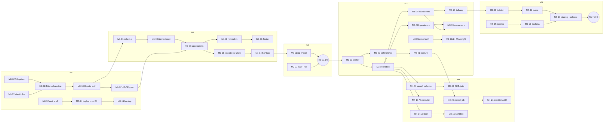

# MVP plan — R0 + R1

> Applyra · 2026-11-16 · автор: architect · Джерела: `docs/spec/02-releases.md` (обсяг, таймлайн, DoD — головне), `03-functional.md` (FR), ADR 000–021. Задачі: `docs/plans/mvp-tasks.md`.

## 1. Мета MVP і exit criteria

MVP = **R0 «Tracker for myself»** + **R1 «Public MVP / Portfolio-ready»**. Спершу автор замінює Google Sheets власним інструментом (dogfooding), потім продукт стає публічним портфоліо-проєктом із demo, CI, observability і ADR.

| Реліз | Exit criteria (`02-releases.md` §2) |
|---|---|
| R0 | усі поточні відгуки автора в Applyra; 7 днів щоденного використання без повернення до таблиці; нічний бекап відновлено вручну хоча б раз |
| R1 | незнайомий рекрутер/інженер відкриває посилання, заходить у demo і за 2 хв розуміє продукт; CI зелений; Grafana показує живі метрики prod |

## 2. Milestones

Тижні й «02, год» — з `02-releases.md` §3 (єдине джерело строків). «План, год» — сума задач `mvp-tasks.md` (core / +optional).

| Milestone | Тижні | Мета | 02, год | План, год | Exit criteria |
|---|---|---|---|---|---|
| M0 Setup | 1 | скелет, CI, auth, prod «hello» (R0-середовище), бекап, spikes | 12–15 | 29 / 30.5 | Google sign-in на prod (R0); CI зелений; `pg_dump` у R2; результати spikes у `CONTEXT.md` |
| M1 Tracker | 2–3 | CRM: заявки, Kanban, Table, Detail, transitions + undo, ручна вакансія, next action, Today | 22–26 | 41.5 / 43 | автор веде нові відгуки в Applyra на prod |
| M2 Migration → **R0** | 4 | CSV import/export, IDOR, полірування | 11–14 | 20 | таблиця автора імпортована; IDOR gate зелений; restore перевірено; тег `v0.1.0` |
| M3 Capture & Notify | 5–6 | outbox + worker, URL capture, нотифікації, stale, email-auth, contacts, interviews, E2E | 30–35 | 65.5 | capture зі stub-сайту, in-app нагадування, E2E flows 1–4 у CI |
| M4 Profile, Jobs & Extraction | 7–9 | профіль, skills, documents, Jobs search, `extract-job`, вибір LLM | 45–55 | 63 | пошук `Reakt` → React; CV upload/parse; ADR провайдера LLM |
| M5 Insights & Launch → **R1** | 10–12 | dashboard, analytics, email/digest, privacy, demo, Prometheus/Grafana, prod, README | 50–60 | 65 / 75 | exit criteria R1; тег `v1.0.0` |

Колонку «02, год» не змінено (орієнтир); «План» — чесна сума задач. Першими при відставанні знімаються `optional` (§7), але це лише ~3 год R0 / ~10 год R1.

**Розбіжність оцінок.** Повна декомпозиція дає R0 ≈ 90.5 год core (02: 45–55), R1 ≈ 193.5 год (02: 125–150). FR не вирізано. Варіанти (рішення автора до старту M1):
1. Прийняти календар: R0 ≈ 5–6 тижнів, R1 ≈ +10–12 тижнів при 15–20 год/тиждень.
2. Тримати дату R0, перенісши в M3 `optional` + нефункціональні шматки M0 (Terraform уже в M5; supply-chain extras; Cmd+K).
3. Скоротити вимоги через `03-functional.md` (наприклад, Table column visibility, `.ics`) — тільки з правкою спеки.
Рекомендація: (1) для R0 — dogfooding важливіший за дату; на R1 переоцінити після M3 за фактичною швидкістю.

## 3. Critical path

Критичний шлях: spikes → Prisma/auth → schema → idempotency → applications/transitions → import → **R0** → worker/outbox → (AI executor, documents, search паралельно) → deletion pipeline → demo → staging + release workflow → **R1**. Gate-задачі релізів (M2-11, M5-28) залежать від усіх не-optional задач свого релізу.

## 4. Milestones детально

### M0 Setup
- **Scope:** FR-AUTH-01…04, FR-PROF-01; E01, E02 (R0), E10 (backups).
- **ADR:** 001, 002, 004, 007, 008, 011, 012, 016.
- **Ризики:** несумісність NestJS 12 з `nestjs-zod`/`@thallesp/nestjs-better-auth` → fallback 11.x (рішення в M0-02, не пізніше); Prisma preview-фічі → raw SQL у міграції; CSP через Pages `_headers` не застосовується → Caddy static.
- **Demo:** prod `app.` (R0-середовище, D-01) → Google sign-in (allowlist) → порожній `/applications`; PR з порушенням boundaries/IDOR gate падає в CI; бекап у R2.

### M1 Tracker
- **Scope:** FR-JOB-01…06, FR-APP-01…13, FR-REM-01…03, FR-DASH-01, FR-PRIV-04; E03, E04, E05 (R0).
- **ADR:** 005 (visibility), 006 (R0 синхронні ефекти), 016 (partial unique).
- **Ризики:** складність optimistic DnD + undo → hook-тести rollback, IK на кожну дію; DST/опівніч у Today → pure functions з fake clock; scope creep UI → shadcn без кастомного дизайну.
- **Demo:** додати вакансію (paste) → заявка → drag у SCREENING → Undo → «Move to…» з клавіатури → next action → з'являється в Today.

### M2 Migration → R0
- **Scope:** FR-IMP-01…06, FR-DASH-02; IDOR suite R0; rate limits.
- **ADR:** —(нові лише за результатами dogfooding).
- **Ризики:** «брудна» таблиця автора (дати, статуси) → мапінг значень + помилки по рядках, preview до commit; повторний імпорт → `importKey`.
- **Demo:** імпорт реальної таблиці → звіт N/M/K → повторний імпорт = 0 нових → експорт CSV відкривається в Excel без формул.

### M3 Capture & Notify
- **Scope:** FR-AUTH-05…10, FR-APP-14…16, FR-REM-04…07, FR-INT-01…05, FR-NOTIF-01, FR-PROF-02, FR-JOB-07, FR-JOB-09.
- **ADR:** 006 (outbox), 009 (SSRF), 021 (capture через worker-чергу), 007 (linking); новий/оновлений — email-провайдер.
- **Ризики:** SSRF-помилка → окремий контейнер + мережева ізоляція + повний набір fixtures + security-reviewer; BullMQ 6 без `@nestjs/bullmq` → обгортка з M0-02; enumeration через тайминг → dummy-hash.
- **Demo:** URL зі stub-сайту → чернетка з бейджами джерел → save; `http://169.254.169.254` → blocked; дзвіночок з reminder due; E2E зелені в PR.

### M4 Profile, Jobs & Extraction
- **Scope:** FR-PROF-03…05, FR-DOC-01…06, FR-DISC-01…05, FR-JOB-08, FR-JOB-10, FR-AI-01, 03, 05, 06, 07, FR-PRIV-03.
- **ADR:** 003 (FTS), 010 (uploads), 017 (AI) + follow-up з вибором провайдера (Q4).
- **Ризики:** upload-парсинг як вектор атаки → sandbox child process + fixtures; витрати LLM → бюджети в PG + global cap + `AI_MODE=off`; якість FTS → integration на реальному PG 18.
- **Demo:** пошук з помилкою в слові; фільтри + hide; CV upload → `READY` → download; capture без JSON-LD → поля `llm` з confidence; таблиця golden set по провайдерах.

### M5 Insights & Launch → R1
- **Scope:** FR-DASH-03, 04, FR-ANL-01…05, FR-NOTIF-02…04, FR-PRIV-01, 02, FR-DEMO-01…06.
- **ADR:** 013 (observability), 014 (demo), 015 (retention), 011 (staging/prod/Terraform).
- **Ризики:** найбільший milestone → optional (WAL-G, Terraform, k6/Lighthouse, admin TOTP) першими йдуть у Later; неповне видалення даних → integration по таблиці сховищ; abuse demo → Turnstile + ліміти.
- **Demo:** «Try demo» → дашборд/аналітика на синтетиці → спроба upload → `Not available in demo`; Grafana з живими метриками; README зі скріншотами.

## 5. Cross-cutting tracks

| Track | M0 | M1–M2 (R0) | M3–M4 | M5 (R1) |
|---|---|---|---|---|
| Security | headers API + SPA CSP, CORS/Origin/cookies, redaction, gitleaks/`pnpm audit`/osv-scanner/CodeQL, allowlist | IDOR на кожен route, CSV injection, rate limits; **`/security-audit` у M2-11** | SSRF fixtures, upload fixtures, enumeration, AuditLog; security-reviewer на M3-20, M4-15 | demo-обмеження, deletion pipeline, CSP final; **`/security-audit` у M5-28 перед тегом** |
| Testing | test infra, IDOR gate, contract helper | DoD §5.1: domain unit ≥ 90% (test-first), integration + IDOR, frontend hooks | DoD §5.2: + Testcontainers для processors/raw SQL, E2E flows 1–4 | E2E 5–6, `@smoke` staging/prod, OpenAPI ↔ routes, a11y; optional k6/Lighthouse |
| Observability | pino + requestId, Sentry api, uptime, Telegram для бекапу | — | worker heartbeat, outbox/capture/AI метрики закладаються в коді | prom-client, Prometheus/Grafana/alerts as code, Sentry web/worker, restore-test workflow |
| Docs / portfolio | README skeleton, `CONTEXT.md`, ADR-нотатки spikes | README (setup), runbook restore | ADR email-провайдер, LLM-провайдер, `docs/ai-evals.md` | README зі скріншотами і діаграмою, `docs/demo.md`, privacy policy, ADR-індекс |

Правило: кожен PR, що змінює структуру/команди/рішення, оновлює `docs/CONTEXT.md`; зміна поведінки — спека + ADR.

## 6. Verification spikes (M0) і відкриті рішення

| Spike | Задача | Fallback |
|---|---|---|
| Prisma 7: partial `@@unique(where:)`, `ops: raw("gin_trgm_ops")`, GIN на `Unsupported("tsvector")`, drift з CHECK | M0-03 | raw SQL у міграції, документовано в ADR 016 |
| NestJS 12 vs 11: peer deps `nestjs-zod` 5, `@thallesp/nestjs-better-auth` | M0-02 | NestJS 11.x |
| BullMQ 6 + `@nestjs/bullmq` (`upsertJobScheduler`) | M0-02 | власна тонка обгортка |
| Better Auth: `generateId` UUID v7, `additionalFields`, `databaseHooks` (allowlist → `SIGNUP_CLOSED`) | M0-02 | `toNodeHandler` + власний guard (ADR 007) |
| R2 presigned PUT з підписаними `Content-Length`/`Content-Type` | M0-16 (optional; інакше старт M4-14) | upload через API з лімітом (ADR 010 переглянути) |
| Cloudflare Pages `_headers` CSP на custom domain | M0-14 | Caddy static з тими самими headers |
| DB roles grants (`applyra_app` без DDL, AuditLog INSERT/SELECT) | M0-03 | — (обов'язково) |

**Spec gaps / рішення до старту відповідної задачі:**
- **D-01 — resolved.** R0-середовище = майбутній prod-хост (реальні дані, allowlist = автор; `deploy-prod.yml`, Environment `production` — M0-13/14); synthetic-only staging — у R1, M5-20.
- **G-02 — resolved (ADR 021).** `POST /jobs/capture` → API ставить BullMQ job `capture` (стабільний `jobId`) і чекає ≤ 6 с; worker викликає safe-fetcher через `fetch-rpc`; api не в `fetch-rpc` (M3-20/21).
- **G-08 — resolved.** `UserJob` — тільки R1; FR-JOB-01 у R0 створює лише PRIVATE `Job` (M1-01/04); створення `UserJob` + backfill — M4-07.
- **G-03 (M4-07).** `JobSkill` у `05-data-model.md` — R2, але FR-DISC-01/03 (навички в картках, фільтр skills) — R1. Пропозиція: `JobSkill` у R1.
- **G-04 (M3-14).** FR-INT-02 «вимикаються глобально в налаштуваннях» — немає поля в `UserSettings`.
- **G-05 (M5-06).** FR-NOTIF-01 подія «stale application» — stale рахується при читанні; механізм генерації нотифікації не визначено (план: щоденний scan у digest-job).
- **G-06 (M5-13).** Куди веде «Request access» (форма / mailto / allowlist-invite) — не визначено; так само зміст privacy policy і `/bot`.
- **G-07 (M4-02).** Джерело й ліцензія seed-каталогу ≥ 300 навичок.
- Дрібне (resolved у спеці): `stale/dismiss`, `PATCH events` і `/api/auth/revoke-sessions` — R1 (M3-11, M3-12, M3-09); невалідна timezone → 400 `VALIDATION_ERROR`; R0 Prisma-схема = елементи `05-data-model.md` §4 без маркера `// R1+`; Cmd+K у R0 optional (M1-20). Відкрите: «theme» у Settings без поля в `UserSettings` (план: localStorage); email-провайдер (Resend vs Postmark) — рішення в M3-04.

## 7. Як виконувати

- **Одна задача = один issue = одна гілка `feat/<id>-slug` = один PR.** Non-trivial (схема, новий модуль, cross-module) → `/feature`; дрібне → `lead-developer` напряму, далі `/review` + `/verify`; spikes → результат у `CONTEXT.md`/ADR.
- Тест-first для `*.domain.ts` (`test-writer` запускає оркестратор до `lead-developer`, або `lead-developer` пише тести сам — субагенти не запускають субагентів); IDOR fixture — у тому ж PR, що й route (gate не дасть змерджити інакше).
- E2E — `/e2e` (playwright-test-planner → generator → healer) з M3; `/security-audit` — тільки M2-11 і M5-28; реліз — `/ship`.
- **GitHub:** milestones `R0` (M0–M2) і `R1` (M3–M5) + milestones-підрозділи `M0…M5`; issue title `M1-08 · Transitions + undo`, body = AC з `mvp-tasks.md` + FR + розділ спеки; епік — label.
- **Labels:** `release:R0|R1` · `milestone:M0…M5` · `epic:E01…E13` · `area:repo|infra|ci|contracts|api|worker|db|web|e2e|security|obs|docs` · `type:feature|chore|spike|bug|docs|security` · `optional` · `flow:feature|direct`.
- Кожен тиждень: звірити факт годин з планом; при відставанні > 20% — спершу знімати `optional`, потім переглядати обсяг через спеку.

## 8. Post-MVP

- **R2 «Discover & Match» (M6–M7, ≈60–80 год, тижні 13–16):** ingestion Greenhouse/Lever/Ashby/DOU RSS, source health; нормалізація, salary USD/міс (курси НБУ, ADR 019) + salary-фільтр Jobs; dedup (external ID → URL → fingerprint).
- Matching v1 (ADR 018): пояснення, confidence, unknowns, feedback; saved searches + digest; OpenTelemetry API → queue → worker; Telegram-бот (Could).
- **R3 «AI Assistant» (M8, ≈45–60 год, тижні 17–19):** analyze-job, tailor-cv, draft-message, recruiter-reply, interview-prep, parse-cv на executor з R1; embeddings (pgvector) + семантичний компонент; golden-set evals `analyze-job`.
- Перед R2 — переоцінка таймлайну за фактичною швидкістю R0/R1 і ревізія `Later`.
