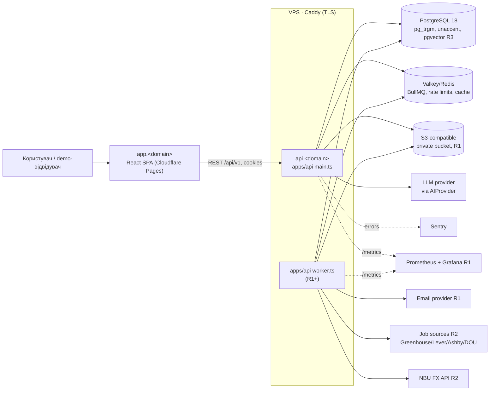
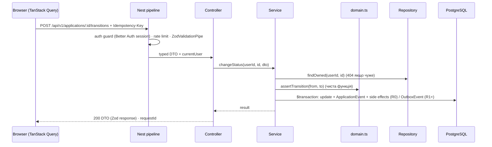
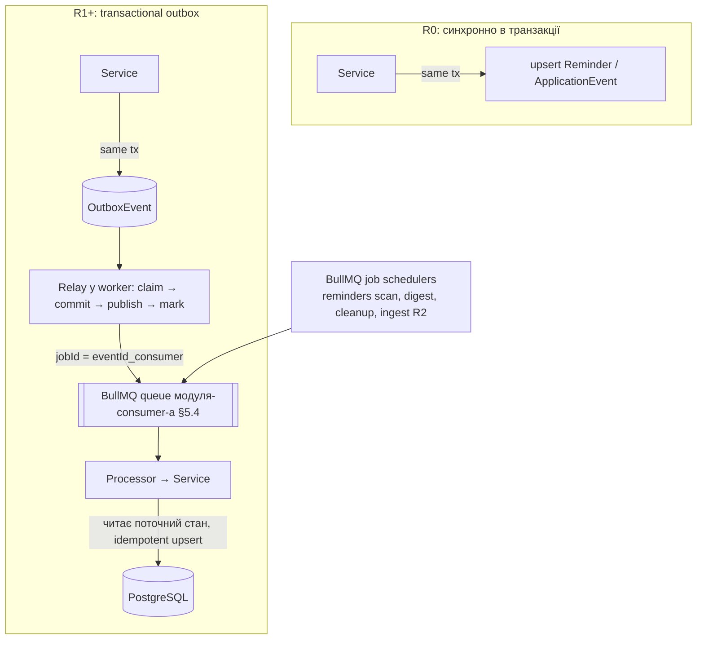

# Architecture

> Applyra spec v2.1 · Зона: архітектурний стиль, модулі, події/outbox, monorepo, tech stack · Пов'язані: `02-releases.md`, `05-data-model.md`, `06-api.md`, `07-ai.md`, `08-ingestion-matching.md`, `09-security-privacy.md`, `10-frontend-ux.md`, `11-testing.md`, `12-infra-ops.md`

## 1. Стиль і обґрунтування

| Рішення | Суть |
|---|---|
| **Modular monolith** | Один NestJS-застосунок `apps/api`, поділений на модулі з явним публічним API (`index.ts`). Один deploy, одна БД, одна транзакція на use case. |
| **Два entrypoints** | `src/main.ts` — HTTP (REST `/api/v1`); `src/worker.ts` — BullMQ processors, outbox relay, job schedulers. Той самий codebase і ті самі services; різні процеси/контейнери. Worker з'являється в R1 (у R0 фонових задач немає, див. §6.1). |
| **Hexagonal-lite у модулі** | `controller → service → *.domain.ts`; `repository` — єдине місце доступу до Prisma. Порти (інтерфейси) — тільки там, де реально є >1 реалізації або зовнішній світ: `AIProvider`, `EmbeddingProvider`, `JobSourceAdapter`, `Mailer`, `ObjectStorage`, `FxRateProvider`. |
| **Спільні контракти** | `packages/contracts` — Zod-схеми DTO, enums, JSONB-shapes; їх використовують `nestjs-zod` (API, OpenAPI) і RHF (web). |
| **SPA** | `apps/web` — React SPA, feature folders; SEO не потрібен; React Router data mode без SSR (див. `10-frontend-ux.md` §4.2). |

**Шари всередині модуля** (узгоджено з `.claude/rules/backend.md`):

| Файл | Може | Не може |
|---|---|---|
| `*.controller.ts` | парсинг (Zod), auth context, виклик service, мапінг відповіді | Prisma, бізнес-правила |
| `*.service.ts` | оркестрація, `$transaction`, виклик domain/repository/інших модулів через `index.ts`, запис outbox | HTTP-об'єкти (`req`, `res`) |
| `*.repository.ts` | Prisma / `$queryRaw` (типізовані хелпери), `findOwned*` | бізнес-рішення |
| `*.domain.ts` | чисті функції, типи з contracts | імпорт `@nestjs/*`, `@prisma/*`, I/O |
| `*.processor.ts` | BullMQ handler → виклик service | бізнес-логіку |

> Відхилення від `.claude/rules/backend.md`: там «Prisma only in repositories/services». У v2.1 — **тільки repositories**; service отримує `tx` і передає в repository. Rule-файл оновити разом зі scaffold.

### 1.1. Чому не інше

| Альтернатива | Чому ні (зараз) |
|---|---|
| Microservices | Соло-розробник, ~15–20 год/тиждень. Distributed transactions, мережеві контракти, окремі deploy і observability з'їдять бюджет R0–R1. Межі домену ще не стабільні — розріз зараз = розріз помилковий. |
| Serverless (Lambda/Workers) | Довгі фонові задачі (ingestion, парсинг CV у child process), постійні з'єднання з PG/Redis, cold start; вендор-lock і складніше локальне середовище. Хостинг — VPS (див. `12-infra-ops.md`). |
| Full Clean Architecture (use-case класи, entities, mappers на кожен шар) | CRUD-домінантний домен; 3–4 мапінги на поле = шум. Чиста логіка вже ізольована в `*.domain.ts`; порти — лише на зовнішніх межах. |
| Monolith без модулів | Втрачаємо тестованість меж і можливість виділення; ESLint-межі (§4.1) коштують майже нуль. |

### 1.2. Критерії виділення модуля в сервіс (interview talking point)

Модуль виділяється, лише якщо виконано **≥ 2** критерії і є метрика, що це підтверджує:

| Критерій | Сигнал | Ймовірний кандидат |
|---|---|---|
| Інший профіль навантаження / масштабування | CPU/RAM worker-а заважає HTTP p95 навіть після розділення процесів | `ingestion`, парсинг документів |
| Інший цикл релізу або команда | окрема людина/команда, конфлікти в deploy | — (соло) |
| Інша модель відмовостійкості | падіння модуля не повинно впливати на CRM | `ingestion`, `ai` |
| Інша технологія | потрібен Python/ML-стек | embeddings, evals |
| Межа вже чиста | модуль спілкується з іншими лише через події та `index.ts`, власні таблиці без cross-module FK у запитах | `ingestion` |

Шлях виділення: (1) модуль уже читає/пише тільки свої таблиці; (2) його події йдуть через outbox → BullMQ; (3) `index.ts` замінюється HTTP/queue-клієнтом з тим самим інтерфейсом; (4) окрема схема PG → окрема БД. Досвід автора з реальною міграцією monolith → microservices: головний урок — спершу межі даних і контракти подій, потім процеси; ця архітектура закладає саме це.

## 2. Діаграми

### 2.1. System context / containers



### 2.2. Request flow (sync)



Помилки — формат і коди див. `06-api.md`; idempotency — див. `06-api.md`.

### 2.3. Async flow (R0 → R1)



## 3. Module map (після рішення 9)

`companies` і `search` → `jobs`; `dedup` → `ingestion`. Разом 16 модулів + `platform` (не модуль: prisma client, config, logger, idempotency interceptor, metrics, outbox writer API).

| Модуль | Відповідальність | Реліз | Public API (`index.ts`) | Таблиці (власник) | Emits | Consumes |
|---|---|---|---|---|---|---|
| `auth` | Better Auth, guard, `CurrentUser`, re-auth | R0 | `AuthModule`, `CurrentUser`, `AllowAnonymous`, `RequireRecentAuth` | Better Auth tables (див. `05-data-model.md`) | — | — |
| `users` | акаунт, `UserSettings`, видалення, demo-користувачі | R0 (delete R1) | `UsersService.getSettings`, `UserSettingsDto` | User, UserSettings, DeletedUserTombstone | `UserDeletionRequested` | `UserDeletionRequested` |
| `jobs` | канонічні Job, visibility, UserJob, capture, companies, FTS-пошук, SavedSearch, salary fields | R0 (пошук R1, SavedSearch R2) | `JobsService.findAccessible`, `upsertFromSource`, `JobAccess` | Job, UserJob, Company, SavedSearch, ExchangeRate | `JobCreated`, `JobUpdated` | — |
| `applications` | pipeline, transitions, ApplicationEvent, contacts, interviews | R0 (contacts/interviews R1) | `ApplicationsService`, `ApplicationStatus` | Application, ApplicationEvent, Contact, Interview | `ApplicationStatusChanged` | — |
| `reminders` | next action, Today/Overdue, доставка | R0 (доставка R1) | `RemindersService.upsertForApplication(tx, …)` | Reminder, ReminderDelivery | — | `ApplicationStatusChanged` |
| `notifications` | in-app, email, digest, Telegram (R2) | R1 | `NotificationsService.notify` | Notification | — | `ApplicationStatusChanged`, `ImportCommitted`, `SavedSearchMatched` |
| `import-export` | CSV import (preview/commit), sync export, full export zip | R0 (zip R1) | `ImportExportService` | ImportSession, DataExport | `DataExportRequested`, `ImportCommitted` | `DataExportRequested` |
| `profile` | CareerProfile, experience, languages, preferences, hard filters | R1 | `ProfileService.getMatchingInput` | CareerProfile | `ProfileUpdated` (R2) | — |
| `skills` | каталог, aliases, нормалізація, extraction зі словника | R1 | `SkillsService.normalize`, `extractFromText` | Skill, SkillAlias, UserSkill, JobSkill | — | `JobCreated`, `JobUpdated` |
| `documents` | upload, versions, парсинг у child process | R1 | `DocumentsService.getParsedText` | Document, DocumentVersion | `DocumentUploaded`, `DocumentDeleted` | `DocumentUploaded`, `DocumentDeleted` |
| `analytics` | funnel, response rate, канали (read-time агрегати) | R1 | `AnalyticsService` | — (read-only запити) | — | — |
| `ingestion` | adapters, scheduling, source health, dedup, FX rates fetch | R2 | `IngestionService` (admin) | JobSource, SourceJob | — (через `jobs`) | — |
| `matching` | скоринг, explanation, MatchFeedback | R2 | `MatchingService.getForJob` | MatchScore, MatchFeedback | `SavedSearchMatched` | `ProfileUpdated`; job `matching/match-job` від skills (§5.4) |
| `ai` | executor, task registry, budgets, AiRun | R1 (extract-job), R3 | `AiExecutor.run(task, input, ctx)` | AiRun, AiUsageDaily, AiGlobalUsageDaily | — | — |
| `outbox` | relay, registry consumer-ів, cleanup | R1 | `OutboxWriter.append(tx, event)` (re-export у `platform`) | OutboxEvent | — | — |
| `audit` | журнал чутливих дій | R1 | `AuditService.record(tx, …)` | AuditLog | — | — |

Колонки таблиць — тільки в `05-data-model.md`. `IdempotencyRecord` належить `platform`.

## 4. Правила модулів

### 4.1. Enforcement: `eslint-plugin-boundaries`

Обрано `eslint-plugin-boundaries` (flat config), а не `no-restricted-imports`:

| Критерій | boundaries | no-restricted-imports |
|---|---|---|
| «Свій модуль — будь-що, чужий — тільки `index.ts`» | одне правило з capture `${module}` | патерн на кожен модуль, легко забути новий |
| Типи файлів (domain не імпортує Nest/Prisma) | element types + `external` rule | окремі overrides на glob |
| Нові модулі | підхоплюються автоматично за `src/modules/*` | треба дописувати конфіг |

Правила (CI падає на порушення, див. `11-testing.md`):
1. `modules/<a>/**` → `modules/<b>/**` дозволено тільки `modules/<b>/index.ts`.
2. `*.domain.ts` → заборонено `@nestjs/*`, `@prisma/*`, `node:*` I/O, `platform/**` (крім типів).
3. `*.controller.ts` → заборонено `*.repository.ts` і `@prisma/*`.
4. `@prisma/client` / згенерований клієнт → тільки `*.repository.ts` і `platform/prisma`.
5. `apps/web` → не імпортує `apps/api`; спільне — тільки `@applyra/contracts`.
6. Циклів між модулями немає: `import-x/no-cycle` на `src/modules/**`.
7. `platform/**` → не імпортує `modules/**` (platform — нижній шар, §4.2).
8. `packages/contracts` → не імпортує `apps/**` і Node core-модулі.

Уточнення реалізації (M0-01, `packages/config/eslint.base.js`, тест `packages/config/test/boundaries.test.ts`):
- Правило 2: заборонені лише I/O core-модулі (`fs`, `net`, `http(s)`, `http2`, `tls`, `dgram`, `dns`, `child_process`, `cluster`, `worker_threads`, `os`, `process`, `stream`, `readline`, `vm`, `v8`, `inspector`, з префіксом `node:` і без); чисті (`crypto`, `util`, `assert`, `path`, `url`, `buffer`) дозволені.
- Правило 4: `platform/prisma/**` імпортують тільки `*.repository.ts` і `platform/**`; виняток — `*.service.ts` може імпортувати `platform/prisma/transaction.ts` (`run(fn)` з непрозорим `Tx`, без Prisma client API). Виняток для композиції (M0-08): корінь застосунку (`src/*.ts`: `app.module.ts`, `main.ts`) і `modules/auth/auth.options.ts` (store Better Auth = persistence модуля auth, `prismaAdapter(PRISMA)`) можуть імпортувати лише `platform/prisma/di.ts` (`PrismaModule`, `PRISMA`, тип `AppPrisma`), не згенерований клієнт.
- Unit-тести (`*.spec.ts` / `*.test.ts` поруч із кодом) звільнені від правил 1–4, `no-cycle` діє; integration-тести — у `apps/api/test/**` (поза `src`, правила 1–4 не застосовуються).

### 4.2. Напрям залежностей

```mermaid
flowchart BT
  platform --> contracts[(@applyra/contracts)]
  auth --> platform
  users --> auth
  jobs --> users
  skills --> jobs
  applications --> jobs
  reminders --> applications
  profile --> skills
  documents --> users
  ai --> users
  jobs -.capture.-> ai
  matching --> profile
  matching --> jobs
  ingestion --> jobs
  ingestion --> skills
  notifications --> users
  analytics --> applications
```

Стрілка = «залежить від» (імпорт через `index.ts`). Правило: якщо нижчому модулю потрібна реакція вищого — подія (outbox), а не імпорт. `ai` — листовий сервіс: знає лише `users` (налаштування/бюджет); контекст збирає модуль-викликач, передаючи дозволені поля (див. `07-ai.md` §5).

### 4.3. Синхронний виклик чи подія

| Потрібно | Механізм |
|---|---|
| Ефект має бути консистентним з основною зміною (reminder при next action, ApplicationEvent, audit) | синхронний виклик public API з передачею `tx` |
| Ефект може відставати, дорогий або зовнішній (email, matching, парсинг, extraction) | outbox-подія (R1+) |
| Ефект за часом (due reminders, digest, ingest, cleanup) | BullMQ job scheduler (`upsertJobScheduler`, ідемпотентний за id) |

### 4.4. Як worker перевикористовує services

- `worker.ts`: `NestFactory.createApplicationContext(WorkerModule)` — без HTTP-адаптера, controllers не монтуються.
- Кожен модуль з фоновими задачами має `<name>.worker-module.ts`, що імпортує `<Name>Module` і реєструє `*.processor.ts`. `WorkerModule` імпортує тільки worker-модулі; `AppModule` (HTTP) — їх не імпортує.
- Processor: десеріалізує payload через Zod-схему з contracts → викликає service → нічого більше.
- Graceful shutdown: `worker.close()` чекає активні jobs (≤ 30 с), relay завершує поточний batch.

## 5. Outbox (R1+) і побічні ефекти R0

### 5.1. R0 (A-03)

Outbox і worker у R0 відсутні. Побічні ефекти — синхронно в тій самій `$transaction`:
- зміна статусу → `ApplicationEvent` + оновлення `lastActivityAt`;
- next action → `RemindersService.upsertForApplication(tx, …)` (Reminder — джерело правди, `nextAction*` — кеш, див. `05-data-model.md`);
- Today/Overdue і «днів без активності» рахуються при читанні.

У R1 ці виклики **не** переводяться на події (вони вимагають консистентності, §4.3); outbox додається для нових асинхронних ефектів.

### 5.2. Алгоритм relay (A-04)

Поля `OutboxEvent` (attempts, maxAttempts, nextAttemptAt, lockedUntil, lockedBy, lastError, publishedAt) і partial index для pending — див. `05-data-model.md`.

1. **Write.** Service у бізнес-транзакції викликає `OutboxWriter.append(tx, { type, aggregateId, payload })`. Payload — мінімальний: ids + `occurredAt` + версія схеми події (Zod у contracts).
2. **Claim (коротка tx).** Relay (worker, цикл кожну 1 с; batch 50): SQL — джерело правди `05-data-model.md` §6.5 (`… ORDER BY "nextAttemptAt" LIMIT 50 FOR UPDATE SKIP LOCKED`, `lockedUntil = now() + 30s`, `attempts + 1`) → **commit**. Транзакція не тримається під час мережевих викликів.
3. **Publish (поза tx).** Для кожного consumer-а з registry типу події: `queues[queue].add(job, payload, { jobId: \`${eventId}_${consumer}\` })`, де consumer = пара (черга, job name) з §5.4, а `consumer` = `<queue>-<job>` (BullMQ забороняє `:` і суто цифрові custom jobId). Повторний publish того самого jobId BullMQ ігнорує, поки job зберігається.
4. **Mark.** Успіх усіх consumer-ів → `publishedAt = now()`, `lockedUntil = null`. Помилка → `lastError`, `nextAttemptAt = now() + min(2^attempts s, 5 хв)`, `lockedUntil = null`.
5. **Dead.** `attempts ≥ maxAttempts` (10) і `publishedAt IS NULL` = dead-letter (окремого статусу немає), метрика `outbox_dead_events` (gauge, `12-infra-ops.md` §10), alert; ручний replay через admin-скрипт.
6. **Crash між publish і mark** → подію буде claimed знову після `lockedUntil`; дубль відсікається `jobId` і ідемпотентністю consumer-а.
7. **Retention.** Job scheduler `outbox:cleanup` (черга `outbox`, job `cleanup`) щодня: видалити `publishedAt < now() - 7 days`. Dead-letter події не видаляються автоматично.

**Consumer-и (BullMQ):** `attempts: 5`, exponential backoff від 5 с, `removeOnComplete: { age: 24h }`, `removeOnFail: { age: 7d }`. Вимоги:
- читати **поточний стан** з БД за id (payload — лише тригер), відсутній/видалений агрегат → no-op;
- ефект — idempotent upsert за природним ключем (`MatchScore` за (userId, jobId), перерахунок лише при зміні `algorithmVersion` або `inputsHash`; `ReminderDelivery` unique (reminderId, dueAt, channel); `Notification.dedupeKey`);
- `ProcessedEvent` (таблиця eventId+consumer) — лише для consumer-а без природного ключа; у v2.1 таких немає (див. «Відкриті питання» у `05-data-model.md`).

**Redis/Valkey недоступний:**
- HTTP-запити, що пишуть дані, працюють: подія вже в PG; relay ловить помилку publish → backoff; події накопичуються і доганяються після відновлення.
- Метрики `outbox_events_pending`, `outbox_lag_seconds`; alert `OutboxLagHigh` (див. `12-infra-ops.md` §10–11).
- Rate limiting: fallback на in-memory ліміт процесу (fail-open з warning у лозі). AI-бюджет у Redis не зберігається (див. `07-ai.md` §4), тому не страждає.
- Health: `/health/ready` worker-а = not ready; API лишається ready (degraded, вказано в `/health`).

### 5.3. Події

| Подія | Emitter | Consumers | Реліз |
|---|---|---|---|
| `ApplicationStatusChanged` | applications | notifications (in-app), reminders (запропонувати follow-up) | R1 |
| `JobCreated` / `JobUpdated` | jobs | skills (extraction зі словника) | R1 |
| ↳ ті самі | | skills consumer після extraction ставить `matching/match-job` (не напряму з outbox — щоб matching бачив свіжі JobSkill) | R2 |
| `DocumentUploaded` | documents | documents (парсинг у child process) | R1 |
| `UserDeletionRequested` | users | users (hard-delete pipeline: БД cascade, S3, Redis keys, Sentry user) | R1 |
| `DataExportRequested` | import-export | import-export (zip у S3, лінк з TTL) | R1 |
| `DocumentDeleted` | documents | documents (видалення об'єкта S3 після commit) | R1 |
| `ImportCommitted` | import-export | notifications (in-app підсумок імпорту) | R1 |
| ↳ правило | | CSV-commit емітує **лише** `ImportCommitted` (одна подія на committed `ImportSession`), без per-row `ApplicationStatusChanged`/`JobCreated`; consumer, якому потрібні імпортовані заявки, читає їх за `importSessionId` з цієї події | R1 |
| `ProfileUpdated` | profile | matching (debounced, див. `08-ingestion-matching.md` §8.4) | R2 |
| `SavedSearchMatched` | matching | notifications (digest) | R2 |

Назви подій у коді — `DomainEventType` (`ApplicationStatusChanged` = `APPLICATION_STATUS_CHANGED`, див. `05-data-model.md` §4.1); таблиця і enum збігаються 1:1. `ApplicationNextActionSet` з v2.0 **видалено**: це синхронний виклик (§5.1).
Часові задачі (не події) — job schedulers з §5.4: `reminders:scan-due` (щохвилини, R1), `notifications:digest` (щодня у TZ користувача, R1), `outbox:cleanup`, `ai:retention`, `deletion:purge-demo` (TTL 24 год), `ingest:run:<sourceKey>`, `ingest:fx-fetch` і `ingest:salary-renormalize` (R2).
Command-черги (не події, не через outbox): `capture` (R1, FR-JOB-07) — API ставить job (`jobId = capture-<sha256(userId|canonicalUrl)>`) і чекає результат ≤ 6 с; worker викликає `safe-fetcher` по `fetch-rpc`; API в `fetch-rpc` не входить (ADR 021, `06-api.md` §8).

### 5.4. Черги та jobs: іменування (M0-02)

BullMQ 6 кидає помилку на `:` у назві **черги**; custom `jobId` не може містити `:` і не може бути цілим числом; job name і id scheduler-а `:` містити можуть (job scheduler-а отримує id `repeat:<schedulerId>:<ts>`). Звідси:

- **Черга** = одна робоча зона worker-а: kebab-case (`^[a-z]+(-[a-z]+)*$`), без `:`. Кожна черга має **одного** модуля-власника з одним `@Processor`, який диспатчить за `job.name` (два Worker-и з різними handler-ами на одній черзі забирали б jobs один в одного). Модуль може мати кілька черг.
- **Job name** — kebab-case дія (`send`, `scan-due`, `match-job`). У специфікації job позначається `<queue>/<job>` (напр. `matching/match-job`); колишні `area:action` = черга `area` + job `action`.
- **Job scheduler id** = `<queue>:<job>[:<key>]` (`:` дозволено), `upsertJobScheduler` ідемпотентний за id.
- **Custom jobId** — тільки через `-`/`_`, не суто цифри: outbox `${eventId}_${queue}-${job}` (§5.2), command/fan-out `<job>-<ключ>` (`capture-<sha256>`, `ingest-<key>-<unit>-<runId>`).
- Метрики: label `queue` = назва черги, `name` = job name (`12-infra-ops.md` §10).

| Черга | Власник | Jobs (тригер) | Реліз |
|---|---|---|---|
| `outbox` | outbox | `cleanup` (scheduler `outbox:cleanup`, щодня) | R1 |
| `email` | notifications | `send` (будь-який лист; ідемпотентний `jobId`) | R1 |
| `notifications` | notifications | `status-changed` (`ApplicationStatusChanged`), `import-committed` (`ImportCommitted`), `digest` (scheduler `notifications:digest`), `scan-stale` (scheduler `notifications:scan-stale`, щодня); `saved-search-matched` (`SavedSearchMatched`, R2) | R1 |
| `reminders` | reminders | `scan-due` (scheduler `reminders:scan-due`, щохвилини), `follow-up` (`ApplicationStatusChanged`) | R1 |
| `capture` | jobs | `capture` (command, ADR 021) | R1 |
| `skills` | skills | `extract` (`JobCreated` / `JobUpdated`) | R1 |
| `documents` | documents | `validate` (`DocumentUploaded`: валідація + парсинг у child process), `delete-object` (`DocumentDeleted`) | R1 |
| `deletion` | users | `delete-account` (`UserDeletionRequested`), `purge-demo` (scheduler `deletion:purge-demo`) | R1 |
| `export` | import-export | `build-zip` (`DataExportRequested`) | R1 |
| `ai` | ai | `retention` (scheduler `ai:retention`, щодня) | R1 |
| `matching` | matching | `match-job` (ставить `skills/extract`), `profile-updated` (outbox `ProfileUpdated` → ставить `match-profile` з debounce), `match-profile` (`08-ingestion-matching.md` §8.4) | R2 |
| `ingest` | ingestion | `run` (scheduler `ingest:run:<sourceKey>`), `fetch` (fan-out з `run`), `fx-fetch` (scheduler `ingest:fx-fetch`), `salary-renormalize` (scheduler `ingest:salary-renormalize`, нічний; пише через `JobsService`) | R2 |

Retention-schedulers M5-10 (`05-data-model.md` §8) — job `cleanup-<model>` на черзі модуля-власника таблиці за цим самим правилом; нова черга — новий рядок цієї таблиці.

## 6. Monorepo

```
apps/
  web/        React SPA · src/features/<feature>/{api,components,hooks,routes}
  api/        NestJS · src/main.ts · src/worker.ts · src/platform/ · src/modules/<name>/
              prisma/schema.prisma · prisma.config.ts · prisma/migrations/
packages/
  contracts/  Zod-схеми, enums, event payloads, error codes (build: tsup → ESM + d.ts)
  config/     спільні tsconfig base, eslint flat config, prettier (лише якщо ≥ 2 споживачі)
e2e/          Playwright (окремий workspace package)
```

### 6.1. Turbo pipelines

| Task | dependsOn | Cache | Примітка |
|---|---|---|---|
| `build` | `^build`, `db:generate` (api) | так, `outputs: dist/**` | contracts будується першим |
| `db:generate` | — | так, inputs `prisma/schema.prisma` | `prisma generate` (Prisma 7: явний `output`) |
| `typecheck` | `^build`, `db:generate` | так | `tsc --noEmit` |
| `lint` | `^build` | так | включно з boundaries |
| `test` | `^build`, `db:generate` | так | Vitest unit (без мережі/Docker) |
| `test:integration` | `^build` (+ `db:generate` з M0-08) | ні (результат залежить від Docker-образів, не від inputs) | Testcontainers, див. `11-testing.md` §3; strict env: лише `passThroughEnv` Docker/Testcontainers-змінних (M0-07a) |
| `e2e` | `build` | ні | Playwright проти compose |
| `dev` | `^build` | ні, `persistent` | web + api + worker |

R0: worker-скрипт не запускається; `dev` = web + api.

### 6.2. Frontend (огляд; деталі — `10-frontend-ux.md`)

- Vite SPA, React Router у data mode (`createBrowserRouter`, lazy routes на feature).
- Feature folders `src/features/<feature>/`; shared UI — `src/components/ui` (shadcn).
- Server state — тільки TanStack Query (query-key factory per feature); Zustand — тільки UI-стан.
- Typed API client поверх contracts; жодних ad-hoc `fetch` у компонентах.
- Forms — RHF + `zodResolver` зі схемами з contracts.
- Optimistic updates для Kanban з rollback та `Idempotency-Key`.
- Untrusted HTML — тільки через `SafeHtml`; AI-вивід — plain text / sanitized markdown (див. `07-ai.md` §8).

## 7. Tech stack (версії станом на 2026-11)

Major-версії фіксуються в `package.json`/`engines`; Renovate тримає minor/patch. ✓ — перевірено вебпошуком 2026-11-16; ◌ — не вдалося підтвердити, звірити на M0.

### 7.1. Платформа і frontend

| Шар | Вибір | Версія | Чому |
|---|---|---|---|
| Runtime | Node.js LTS | 26.x ✓ | Active LTS з 2026-10, EOL 2029-04; `engines.node ^26.13.1` (ADR 024) |
| Package manager | pnpm (глобально через npm, пін = `packageManager`, `pmOnFail: download`; без corepack — ADR 024) | 11.x ✓ | workspaces, `minimumReleaseAge` за замовчуванням — захист supply chain |
| Monorepo | Turborepo | 2.x (2.11) ✓ | кеш тасків локально і в CI |
| Language | TypeScript strict | 6.0 ✓ | 7.0 (Go) GA, але стабільний programmatic API (typescript-eslint) — лише в 7.1 |
| UI | React | 19.x ✓ | стабільна гілка, 20 не вийшов |
| Build | Vite | 8.x ✓ | Rolldown, швидкі збірки |
| Routing | React Router (data mode) | 8.x ✓ | v8 — наступник v7 (той самий API без future flags, ESM-only); SPA без framework mode |
| Server state | TanStack Query | 5.x ◌ | кеш, optimistic updates |
| Tables | TanStack Table | 8.x ◌ | headless, сортування/фільтри |
| UI state | Zustand | 5.x ◌ | мінімальний store для UI |
| Styling | Tailwind CSS | 4.x (4.3) ✓ | CSS-first config, токени як CSS variables |
| Components | shadcn/ui | CLI, компоненти вендоряться ◌ | власний код, a11y на Radix |
| DnD | dnd-kit (`@dnd-kit/core` + sortable) | 6.x ◌ | keyboard sensor (WCAG 2.5.7); `@dnd-kit/react` ще 0.x |
| Forms | React Hook Form + `@hookform/resolvers` | 7.x / 5.x ◌ | uncontrolled, Zod resolver |
| Schemas | Zod | 4.x ✓ | `z.toJSONSchema`, одна схема FE/BE |

### 7.2. Backend, дані, якість

| Шар | Вибір | Версія | Чому |
|---|---|---|---|
| Framework | NestJS (Express 5 adapter) | **11.x** (11.2) ✓ — fallback з M0-02 | DI, модулі. M0-02: `nestjs-zod` 5.6 peer `@nestjs/common` 10–11 (Nest 12 — upstream issue #471, PR #515 відкриті) → 11.x; перейти на 12, коли nestjs-zod додасть peer. api — ESM (`"type": "module"`, `nodenext`): Nest 12 ESM-only, Better Auth і contracts теж |
| Validation/OpenAPI | nestjs-zod | 5.x (5.6) ✓ | Zod 4, `@ZodResponse`, OpenAPI з тих самих схем |
| ORM | Prisma + `@prisma/adapter-pg` | 7.x ✓ | `prisma.config.ts`, явний generator `output`, `.env` не вантажиться сам; 8 — не раніше ніж через місяць після GA |
| DB | PostgreSQL | 18.x ✓ | нативний `uuidv7()`; 19 виходить 2026-11 — не брати до 19.2 |
| Cache/queue store | Valkey (Redis-сумісний) | 9.x ✓ | BSD-ліцензія, drop-in для BullMQ |
| Queue | BullMQ | 6.x ✓ | job schedulers (`upsertJobScheduler`); repeatable jobs у v6 видалено. `@nestjs/bullmq` 12.x ✓ (peer `bullmq ^6`, Nest 10–12; перевірено M0-02 на Valkey 9) + `ioredis` 6 (у BullMQ 6 драйвер — optional peer) |
| Auth | Better Auth + `@thallesp/nestjs-better-auth` | 1.7.x ✓ / 2.x (2.8) ✓ | див. нижче |
| Logging | pino + pino-http + nestjs-pino | 10.x / 11.x / 5.x ✓ | JSON-логи, redaction (M0-09: nestjs-pino 5 — Nest ≥ 11.0.8, Node ≥ 22.12) |
| HTTP security | helmet | 8.x ✓ | API-заголовки `09-security-privacy.md` §9.2 (M0-09) |
| Redis client | ioredis | 6.x ✓ | runtime з R0: readiness PING (M0-09), Better Auth rate-limit store (M0-10), BullMQ (R1) |
| Errors | Sentry (`@sentry/nestjs`, `@sentry/react`) | 11.x ✓ | помилки + release tracking |
| Metrics | prom-client | 15.x ◌ | `/metrics` для Prometheus (R1) |
| Tracing | OpenTelemetry JS SDK | 2.x ◌ | R2: HTTP → BullMQ → worker |
| Unit/integration | Vitest | 4.x ✓ | один runner для web і api; decorator metadata для Nest дає Oxc (Vite 8) з tsconfig — SWC-плагін не потрібен (M0-02) |
| DB tests | Testcontainers (`@testcontainers/postgresql`, `@testcontainers/valkey`) | 12.x ✓ | справжній PG/Valkey у тестах; Node ≥ 22.22, Ryuk увімкнений (M0-07a) |
| E2E | Playwright | 1.65+ ✓ | e2e + agents (`e2e/`) |
| API mocks (web) | MSW | 2.x ◌ | мок мережі в тестах web |

**Better Auth caveats:** інтеграція з Nest — тільки community-пакет `@thallesp/nestjs-better-auth`.
1. Пакет реєструє **глобальний** `AuthGuard`: усі routes приватні за замовчуванням; публічні явно `@AllowAnonymous()` (у коді — alias `@Public()`, як у `09-security-privacy.md`; і тест на перелік публічних routes, див. `11-testing.md`).
2. Потрібно `NestFactory.create(AppModule, { bodyParser: false })` — Better Auth сам читає body; пакет повертає body parsers для не-auth routes. Ліміти розміру body задаються явно (див. `09-security-privacy.md`).
3. `generateId` → UUID v7 (рішення 5). Fallback, якщо пакет зламається: змонтувати `toNodeHandler(auth)` на Express-рівні + власний guard.
4. Allowlist (M0-02): `databaseHooks.user.create.before` кидає `APIError('FORBIDDEN', { code: 'SIGNUP_CLOSED' })` — програмно 403 `{ code }`, OAuth callback → redirect `errorCallbackURL?error=SIGNUP_CLOSED` (SPA передає абсолютний `${WEB_ORIGIN}/sign-in`, FR-AUTH-02); `return false` дає лише `unable_to_create_user`. `user.validateUserInfo` (1.7) не беремо: він перевіряє і повторний OAuth sign-in, а FR-AUTH-02 пускає існуючих без allowlist. `additionalFields` з `input: false` на sign-up мовчки відкидаються з body (не 400), а `update-user` з таким полем відхиляється 400 — роль змінити не можна в обох випадках (тести M0-02).
5. Прямі залежності api: `express` 5 (адаптер сам `require`-ить його, щоб повернути body parsers) і `uuid` 14 (`generateId` = v7 у застосунку; у Node 24 немає вбудованого v7, `uuidv7()` PG18 — лише на боці БД).
6. Секрет: Better Auth без явного `secret` шукає env (`BETTER_AUTH_SECRETS` → `secret` → `BETTER_AUTH_SECRET` → `AUTH_SECRET`), а в кінці бере публічний `DEFAULT_SECRET` (поза production — лише warning). Тому `createAuth` вимагає `secret` ≥ 32 символи, а config (M0-04) відхиляє `BETTER_AUTH_SECRETS`, доки ротацію секретів не прийнято свідомо.

## 8. Over-engineering guard (A-23)

| Свідомо відкладено | До коли / тригер |
|---|---|
| Outbox, worker, BullMQ | R1 (R0 — синхронно) |
| OpenTelemetry traces | R2 (Sentry + Prometheus раніше) |
| Similarity-dedup (pg_trgm, рівень 4) і manual review | Later (див. `08-ingestion-matching.md` §6) |
| CQRS / event sourcing / read models | ніколи без вимірюваної потреби; analytics — read-time SQL |
| Окремі сервіси, Kubernetes, service mesh | критерії §1.2 |
| GraphQL, tRPC | REST + OpenAPI достатньо |
| Repository-інтерфейси «на майбутнє», generic base repository | тільки конкретні repositories |
| Feature flags сервіс | env-конфіг + `UserSettings` |
| Multi-tenant / organizations | Later |
| `LISTEN/NOTIFY` для relay | якщо poll 1 с стане проблемою |
| pgvector, embeddings | R3 |
| Окремий search engine | ніколи до > 1M jobs (FTS + trigram) |

## Зміни відносно v2.0

- **A-03** — R0 без outbox/worker; побічні ефекти синхронно в tx; `ApplicationNextActionSet` видалено.
- **A-04** — relay claim (lockedUntil) → commit → publish → mark; `jobId = eventId_consumer`; maxAttempts 10, backoff, dead-letter, retention 7 днів; поведінка без Redis.
- **A-23 / рішення 9** — 19 → 16 модулів (companies, search → jobs; dedup → ingestion); OTel і similarity-dedup відкладені; таблиця over-engineering guard.
- **Рішення 3, 4** — VPS + Caddy для API, SPA на Cloudflare Pages (`app.<domain>`), `app.`/`api.` same-site у діаграмі контейнерів.
- **Рішення 5** — PostgreSQL 18 (`uuidv7()`), Better Auth `generateId` = UUID v7.
- **Рішення 6** — Prometheus + Grafana у R1, OTel у R2.
- **§5 review (стек)** — версії зафіксовано; Prisma 7 + adapter-pg + `prisma.config.ts`; nestjs-zod v5; BullMQ job schedulers; Better Auth community-пакет із caveats.
- **Нове** — React Router 8 замість 7, NestJS 12 з fallback 11, TypeScript 6 (не 7), Valkey 9.
- **Нове** — `eslint-plugin-boundaries` обрано; Prisma тільки в repositories; критерії виділення модуля; ролі sync-виклику vs події.
- **R-01** — правила модульності перевіряються ESLint у CI, а не «чеклістом».
