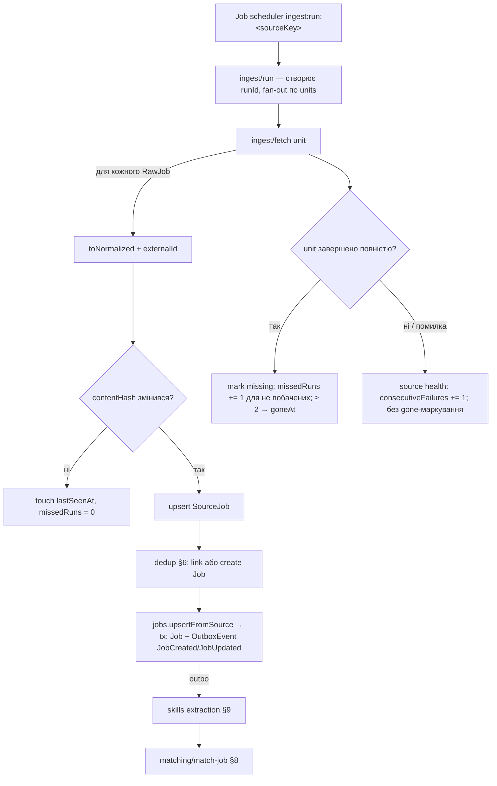

# Ingestion & Matching

> Applyra spec v2.1 · Зона: ingestion (adapters, джерела, flow, health), дедуплікація, salary normalization, matching v1, skills extraction з вакансій · Пов'язані: `02-releases.md`, `03-functional.md` (FR-JOBS-*, FR-MATCH-*), `04-architecture.md`, `05-data-model.md`, `07-ai.md`, `09-security-privacy.md`, `11-testing.md`, `12-infra-ops.md`

## 1. Scope і реліз

**Усе в цьому файлі — R2.** У R0/R1 немає: ingestion, публічних SourceJob, дедупу між джерелами, FX-курсів, нормалізації зарплат у USD, matching, skills extraction з вакансій.

| Що | Реліз | Модуль (див. `04-architecture.md` §3) |
|---|---|---|
| Adapters, scheduling, source health, дедуп (рівні 1–3) | R2 | `ingestion` |
| FX rates (НБУ) + salary normalization | R2 | `ingestion` (fetch) · `jobs` (поля, обчислення) |
| Skills extraction з тексту вакансії (словник) | R2 | `skills` |
| Matching v1 + explanation + feedback | R2 | `matching` |
| Similarity-dedup (рівень 4), manual review | Later | `ingestion` |
| Семантичний компонент matching (embeddings) | R3 | `matching` + `ai` (див. `07-ai.md`) |

Залежність: capture-дедуп за `canonicalUrl` (R0/R1) — див. `03-functional.md`; тут описано лише дедуп ingestion.

## 2. Adapter contract

```ts
export interface JobSourceAdapter<TConfig = unknown> {
  readonly key: string;                               // 'greenhouse' = JobSource.key
  readonly configSchema: z.ZodType<TConfig>;          // валідує JobSource.config
  readonly allowedHosts: readonly string[];           // egress allowlist (див. 09-security-privacy.md)
  readonly rateLimit: { requests: number; perMs: number };
  readonly attribution: { required: boolean; text?: string; url?: string };
  units(config: TConfig): FetchUnit[];                // напр. один unit на board token
  fetch(unit: FetchUnit, ctx: FetchContext): AsyncIterable<RawJob>;   // пагінація всередині
  toNormalized(raw: RawJob): NormalizedJobInput;      // чиста функція → contract-тести на фікстурах
}

export interface NormalizedJobInput {
  externalId: string;                // NOT NULL (A-11): id джерела або externalIdFallback(...)
  canonicalUrl: string;              // після canonicalizeUrl()
  title: string; companyName: string;
  descriptionHtml: string;           // sanitize — у jobs, не в adapter
  publishedAt: Date | null;
  location: LocationInput | null; workMode: WorkMode | null;
  employmentType: EmploymentType | null; seniority: Seniority | null;
  salaryRaw: string | null;          // парсинг — §7
}
```

- **`externalId` завжди заповнений (A-11).** Якщо джерело не дає стабільного id: `externalIdFallback = 'h:' + sha256(canonicalUrl).slice(0, 32)` (для RSS — спершу `guid`, потім hash link). Unique `(sourceId, externalId)` без nullable-дір.
- `FetchContext`: `signal`, rate-limited HTTP-клієнт (лише `allowedHosts`, timeout 15 с, ≤ 5 MB), `If-None-Match`/`If-Modified-Since` з попереднього прогону, logger.
- User-Agent: `ApplyraBot/1.0 (+https://app.<domain>/bot)`.
- Adapter **не** пише в БД і не знає про дедуп — лише видає `NormalizedJobInput`.

## 3. Перші джерела

| Джерело | Спосіб | Unit | Розклад | Нотатки |
|---|---|---|---|---|
| Greenhouse | публічний Job Board API (`boards-api.greenhouse.io`) | board token | кожні 6 год | старт: 20–50 компаній, що наймають в Україні/remote; список — `JobSource.config` |
| Lever | публічний Postings API (`api.lever.co/v0/postings`) | company | кожні 6 год | так само |
| Ashby | публічний Job Board API (`api.ashbyhq.com/posting-api`) | org | кожні 6 год | `includeCompensation` → `salaryRaw` |
| DOU | RSS-стрічки за категоріями | category feed | кожні 2 год | перевірити формат і умови використання до `enabled` |
| Remote OK / WWR | API / RSS | feed | кожні 6 год | Could; Remote OK вимагає attribution |

## 4. Source onboarding / ToS checklist

Обов'язково перед `JobSource.enabled = true`; результат — у `tosNotes`, `tosReviewedAt` і ADR джерела.

- [ ] Офіційна документація або явно публічний endpoint (без логіна, без обходу захисту).
- [ ] ToS / robots.txt прочитано: дозволене використання, кешування, показ повного опису, комерційні обмеження.
- [ ] Attribution: чи потрібна, як показується в UI (`adapter.attribution`).
- [ ] Rate limit задокументовано і закладено в `adapter.rateLimit` (з запасом ×2).
- [ ] `allowedHosts` перелічено; редиректи на інші хости заборонені.
- [ ] Персональні дані у feed (імена/email рекрутерів) — не зберігаються в `rawPayload` (scrub у adapter).
- [ ] ≥ 3 фікстури відповідей у `__fixtures__/<source>/` (зокрема порожня сторінка і невалідний запис); contract-тести без мережі (див. `11-testing.md`).
- [ ] Процедура вимкнення: `enabled = false` видаляє job scheduler; вакансії джерела лишаються до `goneAt`.

## 5. Flow



### 5.1. Scheduling

- Черга `ingest`, іменування — `04-architecture.md` §5.4. Увімкнення джерела → `ingestQueue.upsertJobScheduler('ingest:run:' + key, { pattern }, { name: 'run', data: { sourceKey: key } })` (ідемпотентно за id); вимкнення → `removeJobScheduler`.
- `ingest/run` → по одному `ingest/fetch` на unit з `jobId = ingest-<key>-<unit>-<runId>` (без `:` — обмеження BullMQ custom jobId); concurrency на джерело = 1 (rate limit), між джерелами — паралельно.
- Обробка RawJob — в межах fetch-job батчами по 50 у короткій транзакції; великий feed не тримає tx.

### 5.2. Зникнення вакансій (A-11)

- Лічильник `SourceJob.missedRuns` (колонки — див. `05-data-model.md`) оновлюється **лише після повністю успішного** прогону unit-а (усі сторінки отримано).
- Побачено → `missedRuns = 0`, `goneAt = null` (вакансія «воскресла»). Не побачено → `missedRuns += 1`; `missedRuns ≥ 2` → `goneAt = now()`.
- Усі SourceJob канонічної Job мають `goneAt` → `Job.status = CLOSED` + `JobUpdated`. UserJob/Application користувача не змінюються.

### 5.3. Source health

- Помилка unit-а → `JobSource.consecutiveFailures += 1`, `lastError` (без секретів і тіла відповіді); успіх → `= 0`, `lastSuccessAt`.
- `consecutiveFailures ≥ 5` → `enabled = false`, scheduler видаляється, alert; інші джерела працюють.
- HTTP 429 / `Retry-After` → backoff BullMQ, не рахується як failure до вичерпання attempts.
- Метрики: `ingest_jobs_seen_total{source}`, `ingest_jobs_changed_total`, `ingest_run_duration_seconds`, `ingest_source_failures{source}` (див. `12-infra-ops.md`).

## 6. Дедуплікація

Рівні виконуються послідовно; наступний — лише якщо попередній не дав результату.

| # | Ключ | Дія | `linkMethod` |
|---|---|---|---|
| 1 | `(sourceId, externalId)` | той самий запис джерела → update SourceJob (+ Job, якщо змінились канонічні поля) | `EXTERNAL_ID` |
| 2 | `canonicalUrl` (без utm/tracking params, trailing slash, lower-case host, без `www.`, без fragment) | link до наявної Job | `URL` |
| 3 | fingerprint `dedupKey = sha1(normalizedCompany \| normalizedTitle \| workMode \| countryCode?)` + `publishedAt` у вікні ±21 день | link, якщо рівно 1 кандидат; > 1 → create (не вгадувати) | `FINGERPRINT` |
| 4 | similarity опису (pg_trgm) | **відкладено (A-23)** — Later разом з manual review | `SIMILARITY` |

- Заборони: не об'єднувати різні `companyId`; не об'єднувати, якщо seniority-маркер у title різний (`Senior` vs `Middle`).
- Нормалізація title/company — чисті функції в `ingestion/dedup.domain.ts` (unaccent, lower, без `LLC/Inc/ТОВ`, без суфіксів `(Remote)`).
- Приватні вакансії (capture) дедуплікуються лише в межах користувача та проти публічного каталогу за `canonicalUrl` (див. `03-functional.md`); ingestion приватних Job не чіпає.
- Порядок конкуренції: create Job за `dedupKey` захищений unique/advisory lock на `dedupKey`, щоб два паралельні fetch не створили дубль.

## 7. Salary normalization

### 7.1. Парсинг

`parseSalary(raw: string): ParsedSalary | null` — чиста функція (`jobs/salary.domain.ts`), ≥ 40 unit-кейсів.

| Вхід | Результат |
|---|---|
| `"$3000–4000"` | `{ min: 3000, max: 4000, currency: 'USD', period: 'MONTH', isGross: null }` |
| `"від 2500$"` | `{ min: 2500, max: null, currency: 'USD', period: 'MONTH' }` |
| `"до 120k €/year"` | `{ min: null, max: 120000, currency: 'EUR', period: 'YEAR' }` |
| `"3 000 - 3 500 USD gross"` | `{ min: 3000, max: 3500, currency: 'USD', isGross: true }` |
| `"60 000 грн"` | `{ min: 60000, max: 60000, currency: 'UAH', period: 'MONTH' }` |
| `"competitive"` | `null` |

- Валюта: символи (`$ € £ ₴ zł`), коди ISO, `грн/uah`; невідома валюта → `null` (не вгадувати). Множник `k`. Період за замовчуванням — `MONTH`, якщо в тексті немає маркера.
- Структуровані дані з API (Ashby compensation, JSON-LD) мають пріоритет над парсингом рядка.
- Гроші — integer у мінорних або цілих одиницях + `currency` + `period` (див. `05-data-model.md`).

### 7.2. Курси НБУ (Q7)

- Джерело: офіційний API НБУ `bank.gov.ua/NBUStatService/v1/statdirectory/exchange?json&date=YYYYMMDD` (UAH за одиницю валюти). ADR фіксує вибір НБУ (UAH-ринок, офіційний, без ключа).
- Job scheduler `ingest:fx-fetch` (job `ingest/fx-fetch`, `04-architecture.md` §5.4) двічі на день (07:00 і 17:00 Europe/Kyiv); upsert `ExchangeRate` за (base, quote, date) — ідемпотентно.
- Зберігаються сирі пари `X → UAH`; крос-курс `X → USD = rate(X→UAH) / rate(USD→UAH)` рахується в domain.
- **Fallback last-known:** для дати D береться найновіший курс з `date ≤ D`. Вихідні/свята — штатно. Якщо останній курс старший за 7 днів → нормалізація все одно виконується, але `fx_rate_age_days` метрика + alert; у UI tooltip «rate as of <date>».
- Немає жодного курсу для валюти → нормалізованих значень немає (`null`), оригінал показується.

### 7.3. Нормалізація

- Обчислюються мін./макс. у USD/міс і `fxDate` використаного курсу (поля `Job.salaryMinUsdMonth`, `salaryMaxUsdMonth`, `salaryFxDate` — `05-data-model.md` §4.2).
- Період → місяць: `YEAR /12`, `WEEK ×52/12`, `DAY ×21`, `HOUR ×168`. Gross/net не конвертується (`isGross` лише показується).
- Sanity: результат поза 100…100 000 USD/міс → нормалізоване = `null`, лог warning (ймовірна помилка парсингу).
- Рахується при запису Job і нічним job-ом `ingest/salary-renormalize` (scheduler `ingest:salary-renormalize`) для `OPEN` вакансій у не-USD. `JobUpdated` емітується лише якщо значення змінилось > 3 % (щоб курсові коливання не запускали масовий matching).
- UI завжди показує **оригінал**; нормалізоване — у дужках/tooltip (див. `10-frontend-ux.md`).

## 8. Matching v1 (детермінований)

### 8.1. Компоненти

Кожен компонент повертає `{ score: 0..1 | null, weight, evidence[] }`; `null` = немає даних (unknown).

| Компонент | Вага | Логіка | `null`, коли |
|---|---|---|---|
| Skills | 0.35 | `REQUIRED`: частка збігів (aliases, level ≥ 2) × 0.8 + `NICE` × 0.2; `AVOID`-навичка серед required → −0.15 (min 0) | у вакансії немає JobSkill або в профілі немає UserSkill |
| Seniority | 0.20 | ordinal distance: 0 → 1.0, 1 → 0.6, ≥ 2 → 0.1 | seniority вакансії невідоме |
| Salary | 0.15 | USD/міс: `jobMax ≥ desired` → 1.0; `jobMax ≥ min` → лінійно 0.5…1.0; нижче min → 0.0 | зарплата не вказана або не нормалізована |
| Work mode / location | 0.15 | входить у preferences → 1.0, інакше 0.0 | дані вакансії відсутні |
| Language | 0.10 | CEFR користувача ≥ вимоги → 1.0; на рівень нижче → 0.5; нижче → 0.0 | вимога не вказана |
| Employment type | 0.05 | збіг → 1.0, інакше 0.0 | тип не вказаний |

### 8.2. Формула

```
known       = components where score != null
score       = round(100 * Σ(w·s over known) / Σ(w over known))     -- null, якщо known порожній
confidence  = Σ(w over known) / Σ(w over all)
excluded    = any hard filter violated → score = null, excludedReasons = [...]
confidence < 0.4 → UI "Not enough data" замість числа
```

- **Відсутні дані ≠ 0 балів**: unknown знижує confidence, не score.
- Hard filters (з профілю: work mode, країни, salary min, excluded companies) застосовуються лише до **відомих** значень; невідоме значення не виключає, а йде в `unknowns`.
- Бейдж: Strong ≥ 80 / Good ≥ 60 / Weak < 60 (UI — див. `10-frontend-ux.md`).
- Уся логіка — `matching/score.domain.ts` (чисті функції); `algorithmVersion = 'v1.0'`; будь-яка зміна ваг/правил піднімає версію.

### 8.3. Пояснення

Результат зберігається в `MatchScore` (breakdown — JSONB зі схемою в contracts, див. `05-data-model.md`):

```ts
type MatchExplanation = {
  algorithmVersion: string;
  score: number | null; confidence: number; excludedReasons: ExcludeReason[];
  components: { key: ComponentKey; score: number | null; weight: number; evidence: string[] }[];
  strengths: string[];   // напр. "7/9 required skills: TypeScript, NestJS, PostgreSQL…"
  gaps: string[];        // "Missing required: Kafka"; "Salary below your minimum"
  unknowns: string[];    // "Salary not disclosed"; "Seniority not stated"
};
```

- Тексти strengths/gaps/unknowns генеруються детерміновано з компонентів (без LLM).
- `MatchFeedback` лише зберігається і показується в analytics; автотюнінг ваг — Later.
- AC: golden set ≥ 20 пар (профіль, вакансія) з очікуваними діапазонами score/confidence у unit-тестах (див. `11-testing.md`).

### 8.4. Тригери і debounce (A-23)

| Тригер | Обсяг перерахунку | Механізм |
|---|---|---|
| `JobCreated` / `JobUpdated` | активні користувачі (активність ≤ 30 днів, є CareerProfile) | job `matching/match-job` (ставить consumer `skills/extract`) — один BullMQ job на подію, батчі по 100 користувачів |
| `ProfileUpdated` | вакансії користувача за 30 днів + saved/applied | job `matching/match-profile` з **BullMQ debounce** |
| зміна `algorithmVersion` | усі OPEN вакансії × активні користувачі | разовий backfill-скрипт, rate-limited |

Debounce для `ProfileUpdated` (користувач редагує профіль серією змін):

```ts
matchingQueue.add('match-profile', { userId }, { // черга `matching` (04-architecture.md §5.4)
  delay: 300_000,
  deduplication: { id: `match-profile-${userId}`, ttl: 300_000, extend: true, replace: true },
});
```

Нова подія протягом вікна замінює job і продовжує TTL → перерахунок один раз через 5 хв після останньої зміни, тобто не частіше ніж раз на 5 хв на користувача (FR-PROF-06). Outbox-jobId (`eventId_consumer`, див. `04-architecture.md` §5.2) застосовується до доставки події; debounce — у consumer-і, що ставить фактичну задачу перерахунку.

### 8.5. `inputsHash` (A-22)

`inputsHash = sha256(canonicalJson({ algorithmVersion, profileInput, jobInput, fxDate }))`

| Частина | Вміст |
|---|---|
| `profileInput` | `ProfileService.getMatchingInput(userId)`: skills (id, level, AVOID), seniority, preferences, hard filters, languages, salary min/desired |
| `jobInput` | skills (id, REQUIRED/NICE), seniority, work mode, location, language, employment type, salary USD/міс |
| `fxDate` | дата курсу, використаного для salary вакансії і бажаної зарплати користувача (якщо не USD) |

- Перед записом: hash не змінився → пропуск (no-op), нічого не пишемо.
- Upsert `MatchScore` за (userId, jobId) (PK, `05-data-model.md` §4.4); `algorithmVersion` і `inputsHash` зберігаються в рядку — збіг обох = no-op; повторна подія не створює дублів.

## 9. Skills extraction з вакансій

- Словник `SkillAlias` (модуль `skills`) + word-boundary regex по title і description (plain text після sanitize).
- Неоднозначні aliases (`Go`, `R`, `C`, `Rust` як слово) позначені в словнику як case-sensitive / потребують контексту (поруч `lang`, `developer`, список технологій); інакше пропуск.
- Секції `Requirements` / `Nice to have` визначаються евристикою за заголовками (UA/EN); без заголовків — усе `REQUIRED`.
- Результат — upsert `JobSkill` з `source = DICTIONARY`; LLM-уточнення (`source = LLM`) — R3, опційно (див. `07-ai.md`).
- Тригер — consumer `JobCreated`/`JobUpdated` (див. `04-architecture.md` §5.3); після extraction `matching/match-job` читає вже оновлені JobSkill (consumer matching чекає на skills: matching ставиться в чергу consumer-ом skills, а не напряму з outbox, щоб уникнути гонки).

## Зміни відносно v2.0

- **A-11** — `externalId` NOT NULL з hash-fallback; «зникла 2 рази» через `missedRuns`, лише після повного прогону unit-а.
- **A-22** — `inputsHash` включає `fxDate` і `algorithmVersion`; явний склад profile/job inputs.
- **A-23** — similarity-dedup (рівень 4) і manual review відкладено в Later; debounce `ProfileUpdated` через BullMQ `deduplication` (extend + replace).
- **Q7** — джерело курсів: НБУ; сирі пари X→UAH, крос-курс у domain; fallback last-known + alert при віці > 7 днів.
- **Рішення 9** — дедуп — частина `ingestion`; salary-поля і `ExchangeRate` у `jobs`.
- **Нове** — adapter отримав `allowedHosts`, `attribution`, `units`; scheduling через job schedulers; поріг 3 % для `JobUpdated` після перерахунку курсів; sanity-межі зарплат; hard filters не виключають за невідомими даними; matching ставиться після skills extraction.
- **Явно** — нічого з цього файлу немає в R0/R1.
